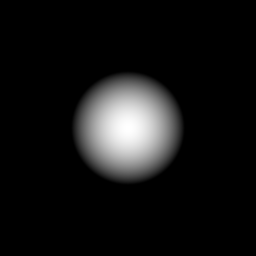

# BlockMap 灯方块

五种灯全部是原生 **一格立方体**（默认边长 1），使用现有 BlockChunkRenderer 的六面网格、顶点色、邻面剔除和自动包边。没有替代模型 Prefab，也不标记为交互道具，能直接刷入地图和烘焙静态网格。原来的五个 ID 和定义 GUID 保留。

| 名称 | 稳定 ID | 面板设计 |
|---|---|---|
| 荧光屏幕 | FluorescentScreen_Lamp | 青绿色明暗横纹 |
| 地板灯 | FloorLight_Lamp | 冰蓝色明暗横纹 |
| 黄灯 | YellowLight_Lamp | 金黄色明暗横纹 |
| 红灯 | RedLight_Lamp | 红色明暗横纹 |
| 立式灯 | StandingLight_Lamp | 暖白色明暗横纹 |

面板采用已确认的蓝灰金属边框、角落螺钉和 **18 条横向明暗条纹**。五种配色由 imagegen 根据原有灯色生成，原图位于 `output/imagegen/LampStripes/<ID>.png`；生成要求为「保留18条细横纹和金属边框，中心及底部指示灯按现有灯色分为明暗两档」。每种灯保持 **64×64 panel/frame**、64×64 发光遮罩和 **512×512 自动包边图集**，与原方块规则一致；原 GUID、定义中的发光色和 Light 参数保留。

菜单 **Tools / Slima / 灯具 / 替换为现有灯色横纹面板** 用原图按最近邻导入 64px，替换面板和对应边框，并同步颜色/发光图集。已有烘焙材质直接引用同一图集，自动采用新贴图，无需重新烘焙网格。该操作校验18条横纹、尺寸、写入结果及GUID。日志：`Logs/LampStripeTextures.log`。

## 使用和调整

1. 在 BlockMap 编辑器的「灯具 _Lamp（发光方块）」分组选择并放置。
2. 使用原有地图保存、读取、擦除和静态烘焙流程；存档记录同样的 ID。
3. 在 Assets/BlockMapEditor/Resources/BlockDefinitions/Lamps 下选择定义，调整 Emission Color/Strength（自身灯面发光）和 Light Color/Range/Intensity（周围照明）。
4. Emission Map 与颜色图集使用相同 UV，黑色外壳和边框不自发光。默认灯光位置为方块中心上方 0.6 单位，可调整 Light Local Position。
5. 运行时点光由原有 BlockMapRuntimeSpawner 生成。单独给 Light 添加 Slima Toon Light，可切换 Pixel/Smooth 和噪波参数。参见 [像素阶梯光照](像素阶梯光照.md)。
6. 启动游戏时，所有开启 `Lamp Halo` 的 `_Lamp` 方块会自动生成二维光晕，不占用 `Max Lights` 点光名额。只在运行时生成，地图烘焙和编辑时不保存光晕对象。

## 二维像素光晕

光晕平面由 `BlockMapLampHalo` 和 `BlockMap/Lamp Halo (Pixel Additive)` Shader 渲染。Shader 按每台实际渲染摄像机的右轴和上轴展开平面，始终面向该摄像机。使用 **Blend One One（线性减淡 / Add）**，将光晕 RGB 加到已有画面；关闭深度写入、开启深度测试，所以其他不透明模型会遮挡光晕。HDR 下多盏光晕叠加可超过 1，Bloom 可额外扩散亮部。

噪波固定在光晕平面的 UV 格内，不以屏幕窗口像素或时间作为种子。径向渐变量化为三档非零亮度，边界像素只在相邻档位之间切换，最外侧过渡到透明。模型表面的五档世界光照和此三档二维光晕分别计算。

在灯具 `BlockDefinition` 的 **_Lamp 运行时二维光晕** 中调整。已生成光晕的尺寸、颜色、亮度和噪波参数可在运行时直接更新；修改 Local Offset 或给原本关闭的灯开启光晕后，调用生成器 Rebuild：

| 参数 | 默认及作用 |
|---|---|
| Lamp Halo | 开关 |
| Lamp Halo Tint | 与 Light Color 相乘，独立调整光晕颜色 |
| Size / Local Offset | 默认直径 1.8 世界单位；位置相对方块中心 |
| Camera Offset | 默认 0.9，沿摄像机方向移到方块表面前；附近遮挡物仍参与深度测试 |
| Intensity | 默认强度 0.6 |
| Gradient Power | 默认 1，控制由中心向边缘的平滑衰减 |

光晕现为纯圆形中心渐变，没有方格、分档或噪声。旧像素参数与形状贴图只保留用于兼容资产，已隐藏且不参与渲染。

纹理位于 Assets/BlockMapEditor/Resources/LampBlocks/<ID>/；同名的 panel/frame 按 BlockMap 约定命名。定义指定已保存的颜色图集，避免烘焙材质丢失临时纹理。颜色和发光图集都由原 AutoTileAtlas.Build 生成，使用同一套上下文索引。

菜单 Tools / Slima / 灯具 / 生成五种 _Lamp 方块（补齐缺失）保留已有 panel/frame/发光遮罩及光照数值，重新合成派生图集。修改源贴图后运行该菜单即可更新图集；地图中的材质需重新打开或重建。新增自定义灯可复制定义与贴图，设置独立的 _Lamp ID；不要把同名替代 Prefab 放进 Resources/BlockModels。

## 渲染和验证

Assets/Scenes/LampShowcase.unity 展示实际 BlockMap 网格和点光照明，材质使用 Slima/Toon (Cel + Pixel)。进入 Play 后自动添加二维光晕；自身发光、周围照明及二维平滑光晕都不依赖 Bloom。

灯具材质与 `_Lamp` 点光的世界光照采样格默认是 0.025（原为 0.06），让灯面、地面和墙面的像素更细密。点光仅覆盖采样格大小，继续使用接收材质的亮度阶梯；SlimaToonLight 启用材质覆盖后可用 World Pixel Size 单独调整。前方二维光晕继续使用无像素噪声的平滑中心渐变。

图中从左到右依次为荧光屏幕、地板灯、黄灯、红灯、立式灯。该场景保存的是实际生成的静态 chunk 网格；地图编辑仍使用原有 BlockMap 场景。

描边保护新增 Protect Material Filter，默认匹配 _Lamp 子网格材质，避免同一 chunk 中的地板描边覆盖灯面；留空可关闭。正交相机的描边深度换算及容差单位也已校正。

此前预览叠加了 Slima Toon Outline 的整屏像素化，Balanced 又以 0.459 的 Render Scale 输出，造成轮廓锯齿。本次关闭三个 Renderer 的 Pixelate Amount，Balanced Render Scale 恢复 1，保留描边。光照边界使用固定世界坐标的噪波方格；格内的距离与阴影取同一个格中心采样，避免把方点切成锯齿碎片。摄像机移动不会让噪波在方块表面滑动；透视下方点随表面投影。原来的整屏像素化仍可以手动开启，但会再次像素化整个场景。

Unity 批处理验证检查：五种资源加载、24 顶点单位立方体、单位法线、相邻两块 40 顶点（共面剔除）、静态烘焙包含、64/512 贴图尺寸、Shader 发光绑定、JSON 往返和五盏点光。世界光照 GPU 回归检查相机移动/缩放/旋转后格子稳定、五档亮度及 Pixel/Smooth 模式。

`SlimaLampHaloValidation.Run` 的 GPU 验证检查连续径向渐变、旧像素参数失效、环绕摄像机后的朝向、线性加法叠加、不透明墙遮挡及零强度。`LampHaloTests` 进入 Play，检查五灯启动时生成、零点光预算仍有光晕、重建无重复、删除后清理、无碰撞体以及编辑模式不生成。日志：Logs/LampHaloValidation.log、Logs/BlockMapLampHaloTests.xml。
