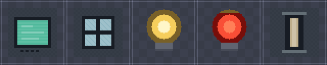
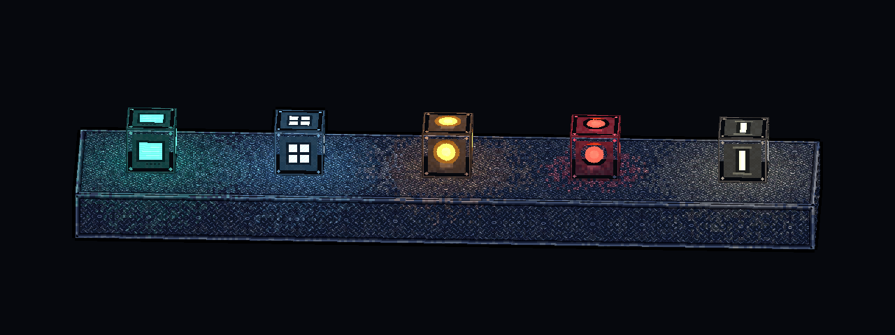

# BlockMap 灯方块

五种灯全部是原生 **一格立方体**（默认边长 1），使用现有 BlockChunkRenderer 的六面网格、顶点色、邻面剔除和自动包边。没有替代模型 Prefab，也不标记为交互道具，能直接刷入地图和烘焙静态网格。原来的五个 ID 和定义 GUID 保留。

| 名称 | 稳定 ID | 面板设计 |
|---|---|---|
| 荧光屏幕 | FluorescentScreen_Lamp | 青绿色扫描线和像素读数 |
| 地板灯 | FloorLight_Lamp | 冰蓝色四格灯面、十字格栅 |
| 黄灯 | YellowLight_Lamp | 沿用原 Lamp 的圆形黄色灯芯 |
| 红灯 | RedLight_Lamp | 原圆形灯芯改为红色 |
| 立式灯 | StandingLight_Lamp | 方块面板内的竖向暖白灯条 |

以 Tools/BlockMapEditor/Resources/Lamp 的原贴图为底稿，保留其金属配色、边框和角落螺钉。每种灯具有 **64×64 panel/frame**、64×64 发光遮罩和 **512×512 自动包边图集**，与原方块规则一致。立式灯也是完整方块，通过竖向灯条体现设计。

## 使用和调整

1. 在 BlockMap 编辑器的「灯具 _Lamp（发光方块）」分组选择并放置。
2. 使用原有地图保存、读取、擦除和静态烘焙流程；存档记录同样的 ID。
3. 在 Assets/BlockMapEditor/Resources/BlockDefinitions/Lamps 下选择定义，调整 Emission Color/Strength（自身灯面发光）和 Light Color/Range/Intensity（周围照明）。
4. Emission Map 与颜色图集使用相同 UV，黑色外壳和边框不自发光。默认灯光位置为方块中心上方 0.6 单位，可调整 Light Local Position。
5. 运行时点光由原有 BlockMapRuntimeSpawner 生成。单独给 Light 添加 Slima Toon Light，可切换 Pixel/Smooth 和噪波参数。参见 [像素阶梯光照](像素阶梯光照.md)。

纹理位于 Assets/BlockMapEditor/Resources/LampBlocks/<ID>/；同名的 panel/frame 按 BlockMap 约定命名。定义指定已保存的颜色图集，避免烘焙材质丢失临时纹理。颜色和发光图集都由原 AutoTileAtlas.Build 生成，使用同一套上下文索引。

菜单 Tools / Slima / 灯具 / 生成五种 _Lamp 方块（补齐缺失）保留已有 panel/frame/发光遮罩及光照数值，重新合成派生图集。修改源贴图后运行该菜单即可更新图集；地图中的材质需重新打开或重建。新增自定义灯可复制定义与贴图，设置独立的 _Lamp ID；不要把同名替代 Prefab 放进 Resources/BlockModels。

## 渲染和验证

Assets/Scenes/LampShowcase.unity 展示实际 BlockMap 网格和点光照明，材质使用 Slima/Toon (Cel + Pixel)。Bloom 只添加光晕；自身发光和周围照明不依赖 Bloom。

图中从左到右依次为荧光屏幕、地板灯、黄灯、红灯、立式灯。该场景保存的是实际生成的静态 chunk 网格；地图编辑仍使用原有 BlockMap 场景。

描边保护新增 Protect Material Filter，默认匹配 _Lamp 子网格材质，避免同一 chunk 中的地板描边覆盖灯面；留空可关闭。正交相机的描边深度换算及容差单位也已校正。

此前预览叠加了 Slima Toon Outline 的整屏像素化，Balanced 又以 0.459 的 Render Scale 输出，造成轮廓锯齿。本次关闭三个 Renderer 的 Pixelate Amount，Balanced Render Scale 恢复 1，保留描边。光照边界使用 Screen 噪波方格；格内的距离与阴影取同一个格中心采样，避免把方点切成锯齿碎片。原来的整屏像素化仍可以手动开启，但会再次像素化整个场景。

Unity 批处理验证检查：五种资源加载、24 顶点单位立方体、单位法线、相邻两块 40 顶点（共面剔除）、静态烘焙包含、64/512 贴图尺寸、Shader 发光绑定、JSON 往返和五盏点光。GPU 回归检查五档亮度、正交/倾斜透视下完整 4×4 方格、边界相邻档位、Pixel/Smooth 和主光/重叠光源。已有 BlockMap EditMode 测试 18/18 通过。日志：Logs/LampBlocksValidation.log、Logs/BlockMapLampTests.xml。
