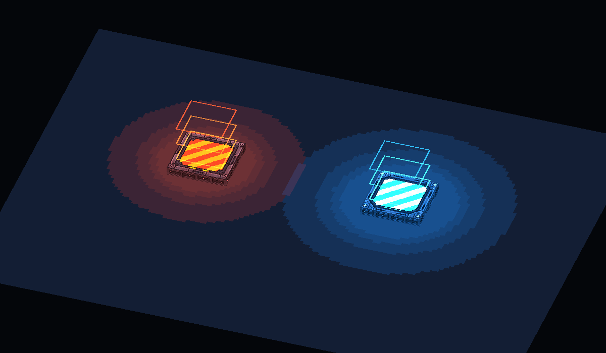
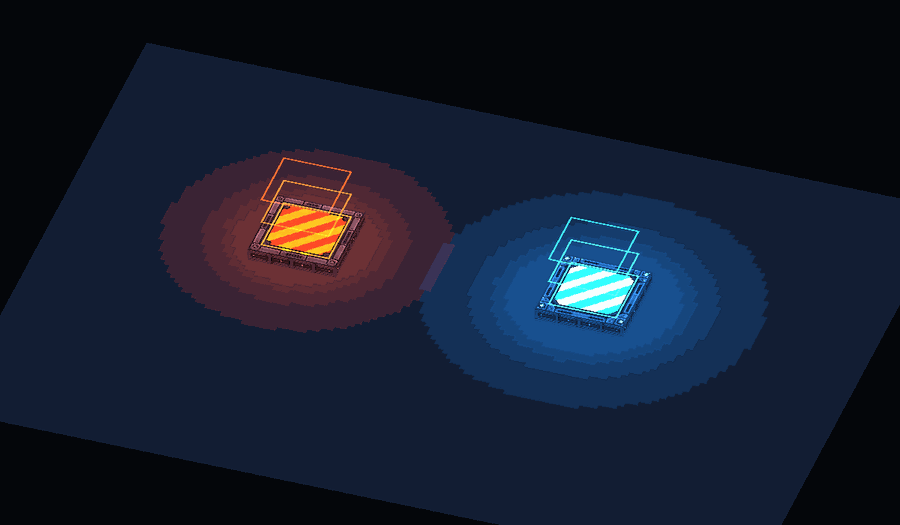

# 元素转换地板发光

火地块 `Lab_Heater_01` 使用红橙交替斜条纹，冰地块 `Lab_Heater_02` 使用蓝白交替斜条纹。64×64，Point 采样，保留金属边框；旧火焰／冰晶图案文件保留。

贴图路径：`Tools/BlockMapEditor/Resources/<ID>/<ID>_Stripe.png`。同目录 `_Emission.png` 是由条纹颜色烘焙的发光遮罩，金属部分为黑色。BlockDefinition 继续沿用原 ID 与转换逻辑。

两种地块均设置自发光强度 1.35、点光源强度 1.6、范围 4。实际浅盒模型尺寸 0.92×0.12×0.92 米，顶部在格位 y+0.12 米，点光源在 y+0.16 米，紧贴实际表面。

模型分为 Top 与 Casing 两部分。Top 使用 64×64 条纹和发光遮罩；Casing 独立使用 `Assets/_Game/Art/Textures/ElementFloors/ElementFloor_Side.png`（64×16、暗色金属），不发光。四个侧面有各自的完整 UV，避免原立方体把顶面整图重复拉伸到侧面。模型位于 `Assets/BlockMapEditor/Resources/BlockModels/ElementFloors/`，网格和材质位于 `Assets/_Game/Art/Models/ElementFloors/` 与 `Assets/_Game/Art/Materials/ElementFloors/`。

取消元素地板悬浮的圆形光晕，改用 ElementFloorRiseEffect：三个 0.72×0.72 米的矩形边框从表面上方 0.006 米处依次升起，每圈生命周期 2.4 秒，上升 0.85 米，透明度随时间衰减并循环。Shader 使用模型空间 XZ 平面的矩形边框，中心镂空，正常受场景深度遮挡；不朝摄像机旋转，也不生成碰撞体。

光框使用不受光的 HDR 线性加法叠加（类似线性减淡）：`背景 RGB + 框线 RGB × _Intensity × 淡出权重`。Shader 为 `Blend One One`，只对框线自身预乘一次淡出权重，保持背景亮度；默认 `_Intensity=6`，在 `Assets/BlockMapEditor/Resources/ElementFloorRise.mat` 调整。淡出为线性 `(1-age)×0.9`，替代此前衰减更快的平方曲线，让中后段的框线仍清晰可见。上升高度、宽度和 2.4 秒生命周期保持一致。

机关生成分支允许 emitLight 方块继续生成点光源；矩形效果跟随模型实例，在运行时生成。原机关视图仍由玩法控制器负责。清理临时灯时先禁用，避免同一帧重建误复用即将销毁的旧灯。

Unity 菜单 `Tools / Slima / 贴图 / 配置元素地板发光` 可重新生成模型、烘焙遮罩和应用参数。

验证：LampHaloTests 2/2 通过，覆盖顶部／侧面贴图分离、侧面不发光、光源相对实际表面的位置、矩形从表面升起并淡出、编辑预览／玩法生命周期、重建与点光源数量限制，以及原 `_Lamp` 兼容。记录：`Logs/ElementGlass/floor-surface-tests.xml`。

静态图和动画由实际 Unity GPU 渲染生成，矩形效果 Shader 正常编译。记录：`Logs/ElementGlass/floor-glow-gpu.txt`。

提亮后的 GPU 验证通过：HDR 发光峰值 7.704；切换灰色背景、关闭场景灯光后，框线对画面的加法贡献保持一致。更新动画仍为每轮 2.4 秒。

## 编辑提示词

### elementSidePrompt

Use case: stylized-concept. Asset type: one production pixel-art texture for the SIDE WALL of a shallow sci-fi laboratory floor pad. New image, not a top-face tile. Wide horizontal strip, aspect ratio 4:1, logical pixel resolution 64 by 16 displayed enlarged with crisp nearest-neighbor pixels. Opaque edge-to-edge strip of dark navy blue-gray metallic casing, straight dark reinforced rails along top and bottom, recessed dark central horizontal panel, four restrained tiny silver square rivets spaced across it, subtle segmented blue-gray metal plates. Neutral dark cool gray only, no orange, no cyan luminous stripes, no fire, no snowflake, no glowing bars, no diagonal hazard stripes, no large square border, no text, no gradients, no perspective, no margins, no objects or rendered model. Flat orthographic surface texture. This will wrap only the four thin sides of a metal floor tile whose upper face has brightly colored stripes. Keep the side casing clean and non-emissive, matching a dark blue-gray pixel laboratory.

使用内置 image_gen 生成侧面贴图，裁切空白边并以最近邻整理为 64×16，最终保存在项目内。

### fireStripePrompt

Edit target: the provided fire conversion floor texture. Preserve the exact outer blue-gray square metallic frame, corner bolts, vents, pixel-art style, dimensions and edge-to-edge top-down framing. Change ONLY the large inner square panel: remove the fire emblem and replace the full inner panel with broad straight parallel 45-degree diagonal alternating RED and ORANGE luminous zebra/hazard stripes, evenly spaced, crisp stair-stepped pixel edges, approximately six alternating broad bands spanning the panel. Red #ed3b23 and orange #ff8e25. Keep the two small orange indicator bars near the bottom. This is a flat production texture, 64x64 logical pixel grid shown enlarged. No text, no drawn annotation or red rectangular markup, no glow leaking into or replacing the gray frame, no realistic surface, no perspective, no blur, no antialiasing. Bright saturated emissive-looking red/orange striped inset, original unlit blue-gray metal outside.

### iceStripePrompt

Edit target: the supplied ICE conversion floor tile texture. Preserve its blue-gray square outer metal frame, corner bolts, vents, pixel-art style and flat top-down edge-to-edge layout. Change ONLY the inset central panel: completely remove the snowflake and fill the whole panel with broad, parallel 45-degree diagonal alternating CYAN-BLUE and ICY-WHITE luminous zebra/hazard stripes, evenly spaced, sharp stair-stepped pixel edges, about six broad alternating bands spanning the panel. Cyan #2cb7ed and pale icy white #c7f8ff. Preserve the two cyan indicator bars at the bottom. Match the warm red-orange striped conversion tile but in cold blue-white colors. Production pixel texture 64x64 logical pixels, enlarged square grid with no antialiasing. No text, labels, annotation, watermark, red rectangle, perspective, new objects, blur, or glowing metallic border. Opaque surface. Central stripes bright and saturated, outer metal unlit dark blue-gray.

使用内置 image_gen 编辑现有贴图，最近邻缩小到 64×64。美术变体保存在项目内。

