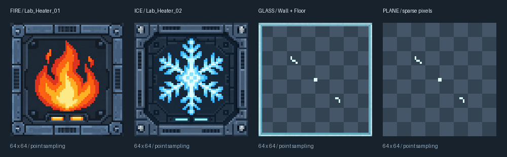
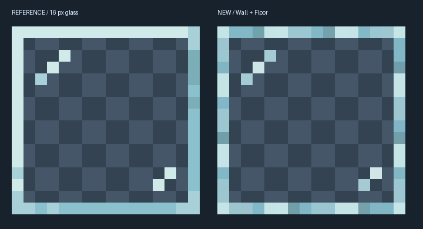

# 元素转换地块与玻璃贴图

转换地块现已更新为发光条纹版，效果与参数见 [元素地板发光](ElementFloorGlow.md)。上图保留初版火焰／冰晶设计。

全部为 64×64 PNG。使用内置 image_gen 生成，并以最近邻缩小至项目尺寸；透明图保留生成的 Alpha。

| 方块 ID | 贴图（位于 `Tools/BlockMapEditor/Resources/<ID>/`） | 用途 |
|---|---|---|
| Lab_Heater_01 | Lab_Heater_01_Stripe.png + Lab_Heater_01_Emission.png | 普通史莱姆转火史莱姆，红橙发光条纹 |
| Lab_Heater_02 | Lab_Heater_02_Stripe.png + Lab_Heater_02_Emission.png | 普通史莱姆转冰史莱姆，蓝白发光条纹 |
| Glass_Wall | Glass_Wall_Plane.png + Glass_Wall_Egde.png | 透明玻璃墙 |
| Glass_Floor | Glass_Floor_Plane.png + Glass_Floor_Egde.png | 透明玻璃地板 |

`_Egde` 按需求保留拼写，通过同目录的显式 BlockDefinition.asset 连接到 frameTexture；`_Plane` 连接到 panelTexture。

玻璃现已按照用户提供的 Minecraft `glass.png` 重做：16×16 逻辑像素放大为 64×64，一像素薄边框，左上三像素、右下两像素的斜向高光。面板共有 80 个有 Alpha 的像素，背景透明；墙与地板同步更新。边框单独分层，使用现有自动包边合成。两者均使用 Transparent、Point 采样、不生成 mipmap、不压缩，保留 RGBA，并使用相同的整格立方体网格和碰撞生成路径，透明区域不影响碰撞。制作记录见 [Minecraft 风格玻璃](GlassMinecraftStyle.md)。

转换地块保留原 ID 和玩法配置，新定义指向新贴图，原 `_simple.png` 保留。红/蓝 tint 改为白色，避免给彩图重复染色。

## 验证

Unity 2022.3.62f3c1 批处理验证通过：四种方块资源可加载，转换地块玩法类型保持 RedFloor / BlueFloor；玻璃透明面板保留稀疏 Alpha，合成图集为 Point 采样。两种玻璃均生成 24 顶点、12 三角形的完整 1×1×1 碰撞网格，逐顶点一致，透明中心向下射线命中。验证记录：`Logs/ElementGlass/validation.txt`。可通过 `Tools / Slima / 贴图 / 验证元素地块与玻璃` 重跑。

## 生成提示词

### firePrompt

Use case: stylized-concept. Asset type: production game pixel-art floor texture, a single flat top-down square filling the entire canvas with no margins. Draw one 64x64 logical pixel tile scaled evenly to 1024x1024 with nearest neighbor pixels, sharp square grid, no antialiasing, no gradients. A slime elemental FIRE conversion floor tile for a sci-fi laboratory: dark blue-grey metal frame around all four edges (8 logical pixels wide), restrained bolts in corners, dark inset panel, centered very clear large orange/red pixel flame emblem with bright pale yellow core, two short amber indicator bars below. Match a detailed blue-gray pixel-art laboratory tile style. Flatter readable pixel art, not a 3D illustration, no perspective, no floating object, no text or labels. Opaque tile, precisely edge to edge. The orange fire is the focus, large simple legible silhouette. No checkerboard.

### icePrompt

Use case: stylized-concept. Asset type: production game pixel-art floor texture, one flat top-down square tile filling the entire image edge to edge. Draw a 64x64 logical pixel tile, displayed enlarged with nearest-neighbor crisp square pixels, no antialiasing, no gradients. A slime elemental ICE conversion floor tile for a sci-fi laboratory: dark blue-grey metal frame around all four edges (8 logical pixels wide), restrained silver bolts in all corners, dark inset panel. Centered very clear large six-armed pale cyan pixel snowflake/ice crystal emblem, evenly symmetric branching snowflake arms, blue midtones and near-white center, two short cyan indicator bars below. Detailed blue-gray pixel-art laboratory tile style, restrained texture, matching a metal fire conversion tile. Flatter readable pixel art, no 3D object or perspective, no margins, no text, no lettering, no checkerboard. The snowflake is the focus, large simple legible silhouette. Fully opaque tile.

### glassPlanePrompt

Use case: stylized-concept. Asset type: Glass_Plane.png production Minecraft-like sparse pixel GLASS texture layer. Output is a square 64x64 logical pixel canvas, enlarged nearest neighbor. FULLY TRANSPARENT background with actual alpha, not a painted checkerboard. There is NO frame or border in this asset. The entire canvas is empty invisible glass except for precisely THREE very tiny detached reflections: one small staircase slash in upper-left quadrant built from 3 pale icy-cyan square pixels, one second 2-pixel staircase slash near lower-right quadrant, one lone icy-white pixel near the center. These little reflections occupy no more than 1 percent of the image area. Hard edges and square pixels, uniform pale icy-cyan color, no gradients, no shadow, no large white diagonal stripes, no blue tint fill, no visible surface, no objects, no text. Keep the reflections inside central 48x48 logical pixels, outer 8 pixels entirely transparent. Almost all pixels transparent. This is an exceptionally minimal transparent glass game texture.

### glassEdgePrompt

Use case: stylized-concept. Asset type: Glass_Egde.png production pixel art glass BORDER layer for a 64x64 logical pixel square game tile, enlarged with nearest-neighbor crisp square pixels. FULLY TRANSPARENT background actual alpha, not a painted checkerboard. Draw ONLY one thin closed square icy-cyan glass perimeter frame flush to ALL FOUR outside edges of the square image. The outermost row and column MUST contain the uninterrupted square frame, no external margins. Border width exactly 2 logical pixels out of 64: darker muted pale cyan outside line, light almost-white cyan inside highlight line. Strictly axis-aligned horizontal and vertical straight thin square lines, four simple square corners, no bevel, no perspective, no rounded corners, no screws, no metal, no fancy frame. Entire central 60x60 logical pixel region fully transparent and empty, ZERO reflection marks inside because these are a separate layer. Almost all of the image empty transparency. Minimal Minecraft glass texture border, no text, no shadow, no gradients, no tint fill, no checkerboard.

