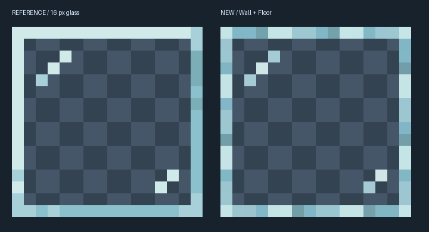

# Minecraft 风格玻璃

参考：`E:/teaCraft/Minecraft_sourceFile/assets/minecraft/textures/block/glass.png`（16×16 RGBA）。使用内置 image_gen 分别编辑面板和边框，以最近邻整理为 16×16 逻辑像素，再放大为项目 64×64，保留透明 Alpha。

新版资源：

- `Tools/BlockMapEditor/Resources/Glass_Wall/Glass_Wall_Plane.png`
- `Tools/BlockMapEditor/Resources/Glass_Wall/Glass_Wall_Egde.png`
- `Tools/BlockMapEditor/Resources/Glass_Floor/Glass_Floor_Plane.png`
- `Tools/BlockMapEditor/Resources/Glass_Floor/Glass_Floor_Egde.png`

边框为一逻辑像素（项目图中 4px）浅青灰色分段轮廓。面板仅有左上三格、右下两格的斜向高光，放大后共 80 个 Alpha 像素。墙与地板图像同步，原 GUID、资源定义与碰撞设置保留。像素尺寸、透明中心与稀疏高光检查通过。

## 面板提示词

Edit the supplied 16x16 Minecraft glass texture into a glass PANEL layer only. Match the reference faithfully: a true 16 by 16 logical pixel grid enlarged evenly with nearest-neighbor square pixels. Remove the entire outer 1-logical-pixel square border so all outermost pixels become fully transparent. Preserve ONLY the five reference diagonal highlight squares inside: three disconnected pale blue-gray/icy-white square pixels at logical coordinates (4,2), (3,3), (2,4), and two pale blue-gray square pixels at (13,12), (12,13), coordinates measured from top-left with zero-based indexing. These form two simple short diagonals sloping up-right, one near upper-left, one near lower-right. Each logical square is exactly 1/16 the canvas width, not tiny subpixel specks. Reference colors: pale gray-cyan #D0EAE9 and muted #A8D0D9. All other pixels truly transparent alpha 0, no painted black/gray or checkerboard background. No outline, no border, no new highlights or clusters, no text, no blur, no antialiasing, no glow. Flat production pixel texture.

## 边框提示词

Edit the provided 16x16 Minecraft glass texture into its BORDER layer only. Faithfully keep the square outer frame and delete the five internal highlight squares: the entire central 14x14 logical pixels must become fully transparent alpha 0. Use exactly a 16 by 16 logical pixel grid, displayed enlarged nearest neighbor. The frame is EXACTLY one logical pixel thick (1/16 canvas width) on all four outside edges, flush to canvas perimeter with ZERO outer margins. A closed simple flat square outline, not a metallic frame. Reference palette: pale gray-cyan #D0EAE9, muted blue-gray #8BC1CD, #A8D0D9 and #7BAEB7, subtly alternate these flat colors in a few short pixel segments on the edge just like the provided original glass. No inner secondary frame, no continuous gradients, no bevels or rim lighting, no shadows, no glow, no screws, no highlights or marks in the middle, no rounded corners, no text, no checkerboard or opaque background. Corner pixels join the one-pixel lines cleanly. Fully transparent interior, actual alpha output. Flat original pixel game glass outline.

