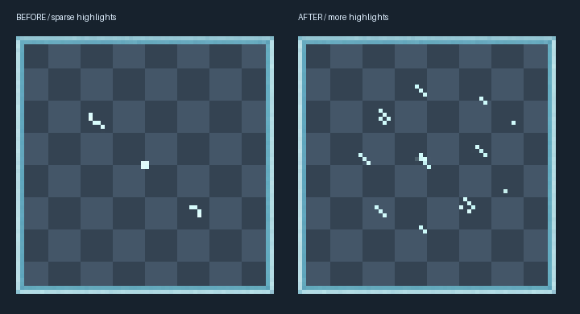

# 玻璃高光像素增加

使用内置 image_gen 编辑原玻璃面板，最近邻缩小至 64×64，并同步保存到：

- `Tools/BlockMapEditor/Resources/Glass_Wall/Glass_Wall_Plane.png`
- `Tools/BlockMapEditor/Resources/Glass_Floor/Glass_Floor_Plane.png`

保留原 PNG 的引用 GUID 和配套 `_Egde` 边框。检查通过：墙／地板图像相同，Alpha 像素 57 个，明显高光像素 33 个，透明区域占绝大部分。验证工具允许 20～80 个 Alpha 像素，以匹配增加后的稀疏高光。

## 编辑提示词

Edit target: provided minimal transparent pixel GLASS PANEL layer. Increase the number of tiny icy-cyan square reflection pixels. Keep a FULLY TRANSPARENT alpha background and do not add any frame or border. Preserve the three existing short reflections and add SEVEN extra detached, short tiny stepped diagonal reflection clusters distributed throughout the central panel, including upper center, upper right, center left, center right, lower left, lower center, so there are about TEN small groups in total. Each group is built from two to three sharp square logical pixels forming a tiny diagonal slash; a few can be isolated single pixels. Pale icy-cyan/off-white only, similar size and color to existing reflection pixels, all the little groups together occupy approximately 35 to 50 pixels out of a 64x64 LOGICAL PIXEL canvas (roughly one percent). Output enlarged crisp pixel art, no antialiasing or gradients. Outer 8 logical pixels on every side remain entirely transparent for autotile border compositing. No continuous stripes, no filled glass tint, no background, no black pixels, no text, no annotations or red marks, no checkerboard, no glow, no frame. The center is still almost entirely transparent but has clearly more evenly scattered tiny diagonal pixel marks than the original.

