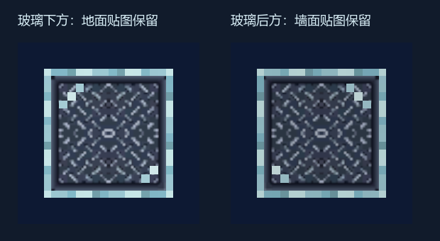

# 玻璃环境光与相邻贴图修复

玻璃保留原透明贴图和整格碰撞。透明材质接入与地形一致的环境球谐光照、场景环境色、主光源及额外点光源；沿用现有 Toon 光照阶梯与每盏灯的设置。旧 `BlockMap/BlockUnlitTransparent` Shader 标识与 GUID 保留，已有烘焙材质可直接使用新的受光实现。

玻璃不再被当成可遮挡不透明邻居的实心面。地面和墙面紧贴玻璃时，会保留原有贴图面；同种玻璃之间仍剔除内部面。渲染判定独立于 BlockWorld 的实心判定，碰撞体积保持不变。

兼容 URP 对透明物体的阴影接收设置，通过带世界位置的主光源查询处理阴影淡出，避免玻璃被错误判成全阴影。

验证：Forward 与 Forward+ 的 GPU 渲染通过环境 SH、方向光、点光、零／半透明混合及紧贴地面／墙面贴图检查。5 个 EditMode 回归用例通过，覆盖跨区块邻接、内部面优化、场景环境参数、整格碰撞与中心射线命中。

验证记录：`Logs/GlassRendering/validation.txt`、`Logs/GlassRendering-tests.xml`。另在隔离副本重建并比较了 5 个含玻璃的烘焙关卡（2-1、3-2、5-2、5-3、5-4）；现有布局的 Chunk Mesh 与重建结果一致，无需改写场景文件。
