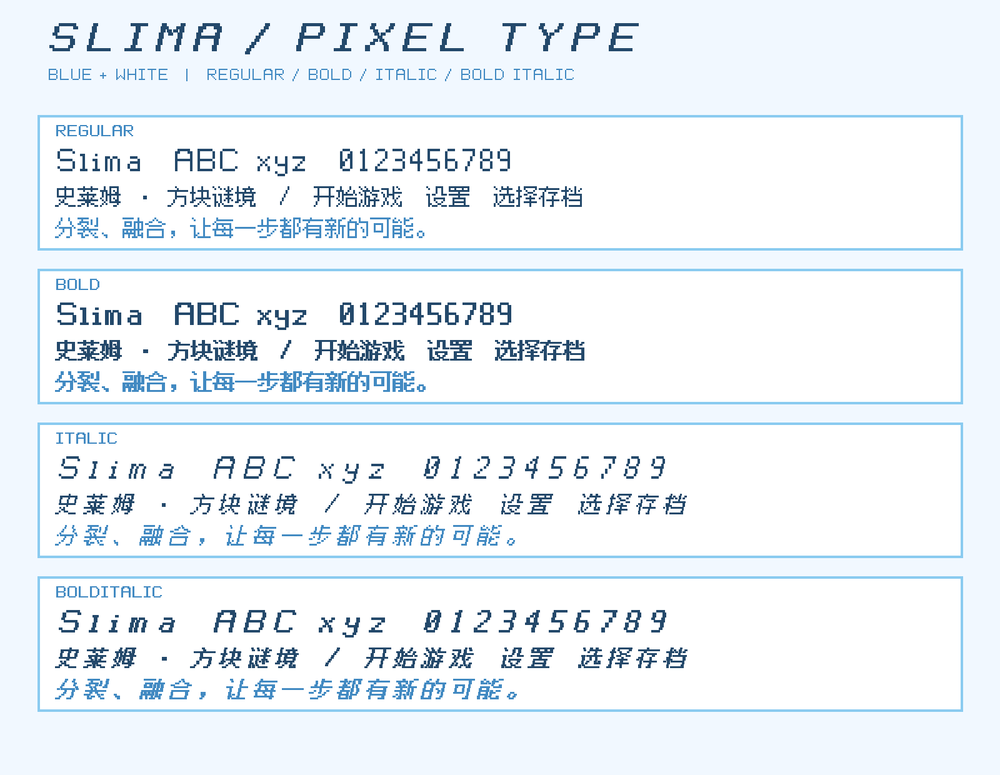
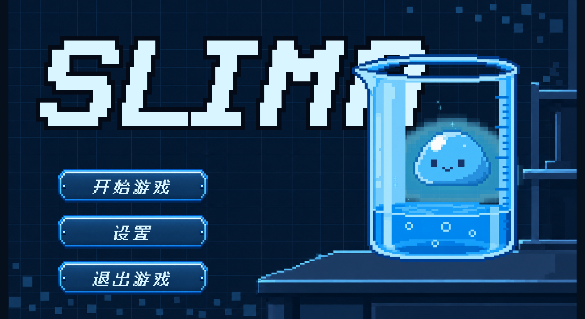

# Slima Pixel UI

为蓝白史莱姆 UI 制作的四款真正的 TrueType 字体，可以用于 Unity，也可以在其他设计软件中安装。

| 字体 | 文件 | 当前界面用途 |
| --- | --- | --- |
| 常规 Regular | `Assets/_Game/UI/Resources/SlimaUI/Fonts/SlimaPixelUI-Regular.ttf` | 正文、存档状态、日期与提示 |
| 加粗 Bold | `Assets/_Game/UI/Resources/SlimaUI/Fonts/SlimaPixelUI-Bold.ttf` | 中文标题、菜单与按钮 |
| 斜体 Italic | `Assets/_Game/UI/Resources/SlimaUI/Fonts/SlimaPixelUI-Italic.ttf` | 保留为可独立使用的字体 |
| 粗斜体 Bold Italic | `Assets/_Game/UI/Resources/SlimaUI/Fonts/SlimaPixelUI-BoldItalic.ttf` | SLIMA 主标题与三个主菜单按钮 |

每款覆盖 **35,111 个 BMP 字符**。字体制作时对界面的 142 个非 ASCII 字符检查，全部覆盖。
英文大小写与数字 62 个字形为项目专门绘制：方正字腔、切角端部、宽 M/W、清楚的 0/O 与 1/I 区分。
中文及其他字符以 [Fusion Pixel Font 12px 简体版](https://github.com/TakWolf/fusion-pixel-font)的点阵字形为基础。
上游版本固定为 [2026.09.01](https://github.com/TakWolf/fusion-pixel-font/releases/tag/2026.09.01)，下载信息在 `Tools/SlimaPixelFont/source/SOURCE.json`。

## 字形设计

采用 12 像素 em、1200 字体单位；英文大写和数字使用 9 像素高度。
加粗版在半像素网格上向右扩笔半个源像素，增加竖笔画重量，同时保留复杂汉字的内白。
斜体以约 14° 阶梯式向右倾斜，保持笔画边缘水平或垂直；不是平滑剪切图片，也不是运行时模拟斜体。
斜体增加字宽以避免相邻字符相碰。四款分别拥有独立字形、度量和字体名称。
像素相邻边合并为闭合轮廓，避免扫描线缝隙，四款文件总计约 27.1 MiB。

## Unity 接入

`SlimaFrontEnd` 通过 Resources 加载所用字体，标题也已使用粗斜体文字取代固定标题图片。
当前界面使用常规、加粗与粗斜体三款，独立斜体字体保留在素材目录。
原来的 `title.png` 保留作为备用图形 Logo。界面使用字体文件直接绘制动态文字。
`SlimaUiFontImport` 指定 `HintedRaster` 无抗锯齿渲染并包含字体数据；字体图集重建时恢复 Point 采样。
打包后无需依赖玩家电脑安装微软雅黑等字体。
原生像素最整齐的字号是 12 的倍数；UI 的其他字号使用单色栅格化，仍保持硬边。
主菜单标题采用 240 号粗斜体，按可见字面紧密排列（间距 4 个设计像素），浅色笔画向外扩粗 6 像素，外加 10 像素深蓝描边，位于烧杯图层之后；字形按标题区域横向适配。三个按钮采用 36 号粗斜体。位置和动效调节见 [暗色 UI 与史莱姆动效](暗色UI与史莱姆动效.md)。
整幅界面随窗口等比例缩放，非整数窗口比例可能使屏幕上的部分像素宽度有所变化。

## 构建与授权

源码在 `Tools/SlimaPixelFont/build_font.py`；依赖见同目录 `requirements.txt`。
安装依赖后运行 `python Tools/SlimaPixelFont/build_font.py` 即可重建字体、字形预览和 `build-report.json`。
源点阵已保存在项目内，重建不需要再次下载。

验证包括字体文件回读、Unicode 覆盖、字重标记以及四款字体的实际栅格结果与源像素逐点比较，
覆盖英文、数字、中文、字腔与斜向接触点。

Unity 独立副本运行验证已通过：四款字体嵌入、中文覆盖、HintedRaster、Point 图集、加粗轮廓与斜体度量。
主菜单、新游戏、暂停、设置、保存、继续、下一关、重开和存档槽隔离回归也全部通过。
日志：`Logs/PixelFontValidation.log`。运行截图已更新至 `Docs/images/SlimaMainMenu.png`、`SlimaSaveSlots.png` 和 `SlimaSettings.png` 等文件。
验证副本已清理。

这套字体是经过改名的 OFL-1.1 衍生字体，包含原创英文数字字形及上游中文基础；不是全部汉字重新手绘。
字体目录附带 `OFL.txt` 和 `LICENSES/`，保留 Fusion Pixel 及其上游 Ark Pixel、Cubic 11、Galmuri 的授权文件。
分发字体时请一并保留这些授权文件；字体可以随游戏分发。完整授权以随附文件为准。
