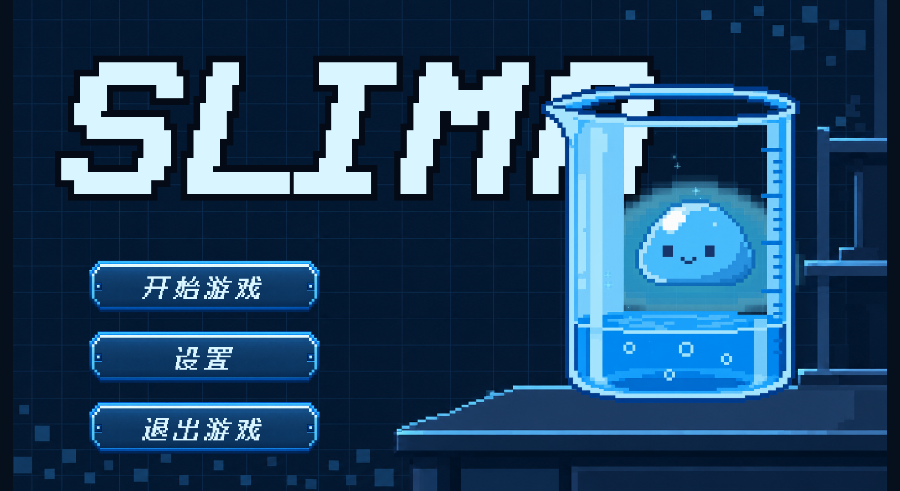
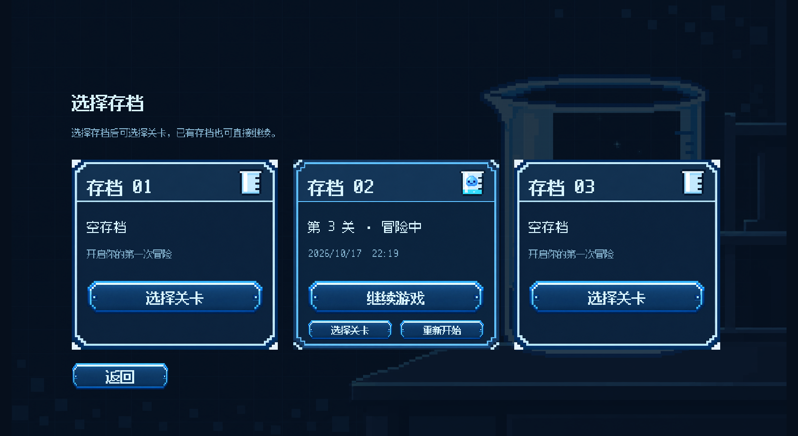
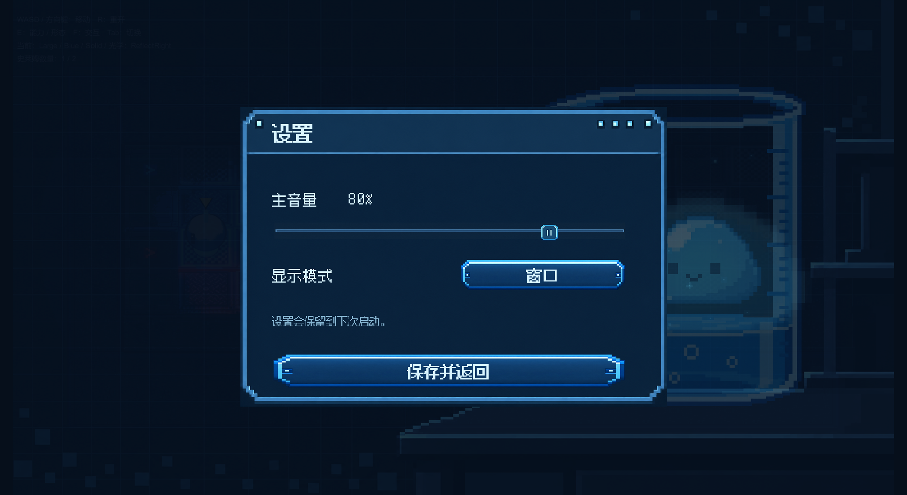

# UI 蓝白像素素材

当前运行界面已切换为 [暗色 UI 与史莱姆动效](暗色UI与史莱姆动效.md)。本文记录保留的原蓝白素材；暗色版本独立存放于 `SlimaUI/Dark/`。

使用内置 `image_gen` 工具绘制，9 张基础 PNG 和 3 张封面分层 PNG 已复制进项目；不是运行时生成。
`SlimaFrontEnd` 通过 `Resources.Load("SlimaUI/...")` 加载，Unity 打包时会包含这些图片。

| 文件 | 用途 | 原图尺寸 |
| --- | --- | --- |
| `Assets/_Game/UI/Resources/SlimaUI/cover.png` | 保留的原始合并封面，供参考 | 1672 × 941 |
| `Assets/_Game/UI/Resources/SlimaUI/cover-background.png` | 去除烧杯和史莱姆后的封面背景 | 1672 × 941 |
| `Assets/_Game/UI/Resources/SlimaUI/cover-beaker.png` | 独立烧杯 Sprite，透明内腔和外围 | 1145 × 1374 |
| `Assets/_Game/UI/Resources/SlimaUI/cover-slime.png` | 独立史莱姆 Sprite，透明背景 | 1385 × 1136 |
| `Assets/_Game/UI/Resources/SlimaUI/title.png` | 备用 SLIMA 图形 Logo；当前标题改用专用字体 | 2172 × 724 |
| `Assets/_Game/UI/Resources/SlimaUI/button.png` | 所有按钮；悬浮、按下和禁用时调整颜色 | 2172 × 724 |
| `Assets/_Game/UI/Resources/SlimaUI/panel.png` | 设置、暂停、确认弹窗与提示面板 | 1536 × 1024 |
| `Assets/_Game/UI/Resources/SlimaUI/slot-empty.png` | 空存档：空烧杯图标 | 1254 × 1254 |
| `Assets/_Game/UI/Resources/SlimaUI/slot-saved.png` | 已有存档：烧杯中悬浮的史莱姆 | 1254 × 1254 |
| `Assets/_Game/UI/Resources/SlimaUI/slot-complete.png` | 当前关卡通关存档：史莱姆与蓝色勾号 | 1254 × 1254 |
| `Assets/_Game/UI/Resources/SlimaUI/slider-track.png` | 音量滑块轨道 | 2172 × 724 |
| `Assets/_Game/UI/Resources/SlimaUI/slider-thumb.png` | 音量滑块手柄，透明背景 | 1254 × 1254 |

保留完整生成图片与透明通道。按钮使用 UV 裁去上下透明留白；其余图片完整显示。
`SlimaUiTextureImport` 仅处理这个素材目录：Point、Clamp、无 Mipmap、无压缩、不缩放 NPOT、最大边长 4096。
界面以 1280 × 720 等比例缩放；中文文字保留动态绘制，避免图片文字错误，支持存档状态与时间更新。
字体统一使用 [Slima Pixel UI](Slima像素字体.md) 的常规、加粗、斜体和粗斜体四款字形。
封面采用背景、烧杯、史莱姆三个独立层，Inspector 调整方法见 [封面插画分层](封面插画分层.md)。

## 生成提示词

共同美术约束：simple authentic low-resolution pixel art; hard square pixel edges; flat shade clusters;
blue/white palette `#f1f8ff`, `#d7ebfa`, `#8acbf0`, `#428ac2`, `#24496b`;
no antialiasing, no gradients, no watermark. 除标题外全部无文字。

以下记录各张最终素材的构图要求与修订提示，便于继续扩展这套素材：

- **封面**：production game main-menu background, widescreen 16:9. Large generous clean ice white negative space across left 52% for runtime title and three buttons, faint blue square grid. Right: cute blue slime levitating midway inside a large clear cylindrical laboratory beaker, open top and pouring spout, not a flask or closed bottle. Navy square eyes and tiny smile, sparse graduation ticks, cyan liquid only at bottom, visible gap between slime and liquid. Few pixel bubbles and cross sparkles. Minimal light blue laboratory tabletop on right. No UI cards or buttons in artwork.
- **标题**：Text verbatim "SLIMA", exactly S L I M A. Bold blocky pixel-font wordmark, navy outlines, medium blue face, ice white top highlight, pale cyan offset bottom shadow. Wide 3:1 canvas, transparent background, no icons or additional words.
- **按钮**：one wide horizontal production button background, stepped corners, very pale icy blue face, medium blue outline, white top highlight, dark blue bottom/right shadow, tiny inset square rivet at each end. Center 80% blank for runtime text. Transparent outside artwork. Exactly one button, not a sprite sheet or mockup.
- **面板最终修订**：keep blue border and stepped corners, pale blue header and tiny square bolts/indicators. Fill entire central interior with completely opaque uniform ice white. No dark center, no transparency in center, no gradient, no vignette or airbrush. Empty central surface for runtime text.
- **空存档最终修订**：preserve square card geometry, blue border, stepped corners and pale blue header. Completely opaque ice white center. Small empty straight-sided open-top cylindrical beaker at top right, blue glass outline and three graduation ticks, within top 18% height. Not a conical flask. No drawn buttons.
- **已有存档**：edit only empty beaker icon at top right of empty card into the same beaker holding a tiny cute blue slime suspended midway. Two navy eyes and smile, cyan liquid at bottom with a gap below floating slime. Preserve exact card geometry, border, blank opaque interior, header, colors and pixel style.
- **通关存档**：edit only top-right beaker icon into same beaker with floating blue slime plus small dark blue pixel checkmark just to lower right, contained within header. Keep exact card geometry and empty opaque interior. Checkmark blue, not green.
- **滑块轨道**：one thin horizontal pale blue inset rail centered vertically on opaque ice white wide 3:1 canvas, spanning edge to edge. Navy single pixel outline, white bottom highlight, straight square corners, no knob, no text.
- **滑块手柄**：one chunky square knob on transparent canvas, medium blue outline, navy bottom shadow, ice white face, two short vertical blue center grooves, stair-step cut corners, crisp square pixels, no text.

生成过程中的透明中心面板与锥形瓶草稿没有接入项目；最终卡片和面板为不透明内表面。

## 运行验证

在独立 Unity 项目副本中通过 `SlimaFrontEndPlayValidation.Run`：主菜单、新游戏、暂停、设置、保存、继续、下一关、重开与存档槽隔离全部通过。
另检查 9 张图片均可由 Resources 加载，Point 采样和单层 Mipmap 设置正确。
通过实际运行截图调整了设置和确认弹窗的标题位置，避免与分隔线重叠。
三个存档卡片的预览使用隔离测试数据，展示已有、通关和空存档三种状态。
测试日志保留在 `Logs/UiArtValidation-final.log`，验证副本已清理。

其余截图：[暂停](images/SlimaPause.png)、[重开确认](images/SlimaResetConfirm.png)、[退出确认](images/SlimaQuitConfirm.png)。
