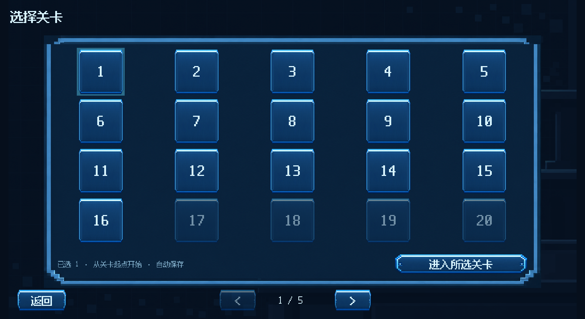

# 主菜单、选关与自动存档

打开 `Assets/_Game/Scenes/MainMenu.unity` 后按 Play，或使用菜单 `Tools / Slima / 主菜单 / 打开主菜单`。
Build Settings 已将它设为第一个场景，打包后从主菜单启动；直接 Play 关卡仍可用于开发调试。

界面现使用深蓝底与冰蓝高光的暗色像素素材，封面右侧为悬浮在烧杯中的发光史莱姆，并带有上下浮动与像素粒子动画。当前图片位于
`Assets/_Game/UI/Resources/SlimaUI/Dark/`，包括封面背景、按钮、弹窗面板、音量滑块与透明光晕。独立烧杯、史莱姆和字体位于上级目录；旧存档卡图片保留为备用素材。
设置、暂停、切关和退出确认共用同一套图片。中文按钮文字由代码实时绘制。
纹理采用 Point 采样、关闭 Mipmap 和压缩，生成说明见 [UI 蓝白像素素材](UI蓝白像素素材.md)。
标题、按钮和正文使用专门制作的 [Slima Pixel UI 像素字体](Slima像素字体.md)，包含常规、加粗、斜体和粗斜体。
烧杯与史莱姆已拆为透明 Sprite，可以在 `SlimaFrontEnd` 的 `Beaker Rect` / `Slime Rect` 分别调整位置和大小，见 [封面插画分层](封面插画分层.md)。
主菜单按标注精简为大标题与三个操作按钮：移除了顶部标语、中文副标题、介绍文案、存档提示和英文页脚。
标题使用现有 240 号粗斜体像素字体，按字面边缘收紧间距、加粗笔画和深色描边，并由前景烧杯遮挡；按钮高度 76、垂直空隙 28，坐标见 `SlimaFrontEnd.DrawHome`。Inspector 调节项与生成提示词见 [暗色 UI 与史莱姆动效](暗色UI与史莱姆动效.md)。
当前直达选关流程通过 Unity 独立副本验证，日志为 `Logs/DirectLevelEntryValidation.log`；标题与烧杯层级的运行预览日志为 `Logs/TitleTypographyPreview-final.log`。

- **开始游戏**：直接打开选关页面，自动选择已有进度对应的关卡。
- **设置**：主音量、全屏 / 窗口切换，设置保留到下次启动。
- **退出游戏**：确认后退出；Unity 编辑器中停止 Play。

## 关卡选择

入口：**开始游戏 → 选择关卡**，不再显示存档选择页面。每页固定显示 **20 个正方形关卡选项，每行 5 个、共 4 行**，按钮仅显示数字。顶部页码栏及分隔线已移除，仅由底部左右箭头切换五页；不按章节分组。编号连续排列：第 1 页为 1–20，第 2 页为 21–40，依此类推。当前 1–16 对应已有场景，其余位置为灰色预留数字，不可进入。

标题位于页面左上方，返回按钮位于左下方，翻页箭头和当前页数位于底部中央。点击关卡后，再点击“进入所选关卡”。

选择已有进度对应的关卡时，点击“继续所选关卡”恢复原进度；选择其他关卡时，确认后从该关起点开始并替换当前进度。取消、浏览和翻页不会写入存档。按 Esc 或点击“返回”直接回到主菜单。

手动配置：打开主菜单场景，选中 **Slima Main Menu → Slima Front End → Level Scenes**。数组共 100 项，Element 0–99 对应五页的第 1–100 关；每 20 项对应一页。填入场景的项目路径（例如 `Assets/Scenes/test-level 1-0.unity`），并将场景加入 Build Settings。空路径或未加入 Build Settings 的位置显示灰色禁用数字。关卡格子位置在 `SlimaFrontEnd.DrawLevels()`：起点 `(158,112)`，每列间距 216、每行间距 112，按钮大小 `100×100`。正方形按钮复用原按钮图的边角和中心，保持像素边框厚度。

自动配置启动场景的工具依据 `SlimaFrontEnd.DefaultLevelScenes` 生成 Build Settings；新增关卡后如需继续使用该工具，请同步更新这份默认场景表。

游戏中按 **Esc** 打开暂停菜单，可以保存、修改设置、保存并返回主菜单或退出。
按 **F5** 手动保存。移动、分裂、融合、交互、重开和通关后的稳定状态会自动保存。
打开暂停菜单时，会先等当前移动结束，避免把一半的滑行或融合过程写进存档。

进度保存当前场景、地图变化、所有史莱姆的位置与朝向、大小 / 元素 / 形态 / 光学能力、控制权、机关开关与锁存状态、通关状态，以及保存时间。
界面自动使用 `Application.persistentDataPath/Saves/slot-1.json`，与地图编辑器的 `Maps` 数据分开。兼容原来的第一个存档，原 `slot-2.json` 和 `slot-3.json` 文件保留，界面不再提供切换入口。
存档先写临时文件，再替换旧文件。进度文件损坏时，也须在选关后确认替换才会重建，浏览页面或取消确认不会覆盖旧文件。

当前配置 16 个场景，顺序从 `test-level 1-0` 到 `test-level 5-4`；其余位置预留。到达终点后可点击“下一关”，自动跳过空位置，最后一个已配置关卡完成后可返回主菜单。
要调整关卡顺序，请修改主菜单场景中 `SlimaFrontEnd.levelScenes`，并把对应场景加入 Build Settings。

## 验证

- EditMode 测试：`GameplayProgressTests` 检查分裂角色 / 控制权恢复、地图变化、机关信号恢复和暂停。
- 批处理入口 `SlimaPuzzle.EditorTools.SlimaFrontEndSetup.Validate` 检查存档槽独立性、覆盖写入、损坏存档与启动场景。
- 批处理入口 `SlimaPuzzle.EditorTools.SlimaFrontEndPlayValidation.Run` 检查主菜单、新游戏、暂停、设置、读档、下一关与重新开始，并输出截图。验证使用独立的临时存档目录。
- 批处理入口 `SlimaPuzzle.EditorTools.SlimaLevelSelectValidation.Run` 检查开始游戏直达选关、自动存档、五页各 20 个数字选项、翻页边界、后续页面配置、预留关卡禁用、浏览/翻页/取消不写档、继续原进度、切关确认、损坏进度确认重建及旧存档隔离，并输出选关、第二页和确认页截图。验证在独立项目副本运行；最新正方形布局日志为 `Logs/SquareLevelSelectValidation.log`。
