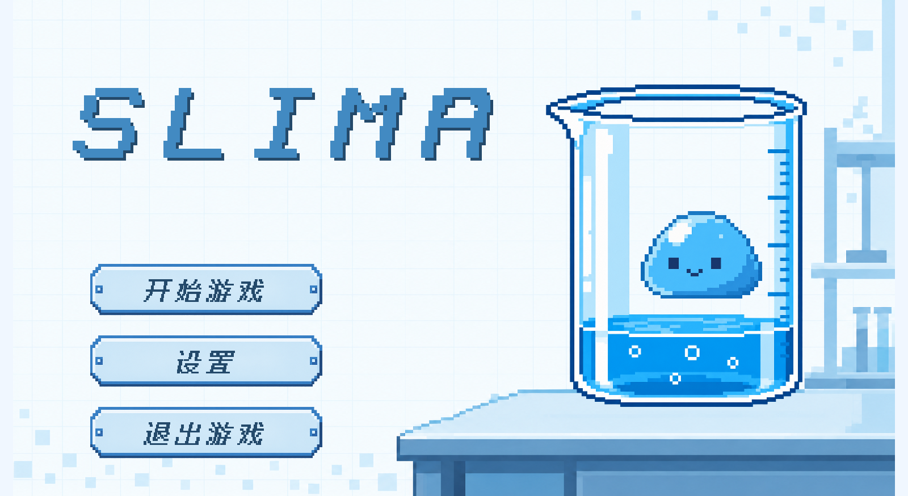
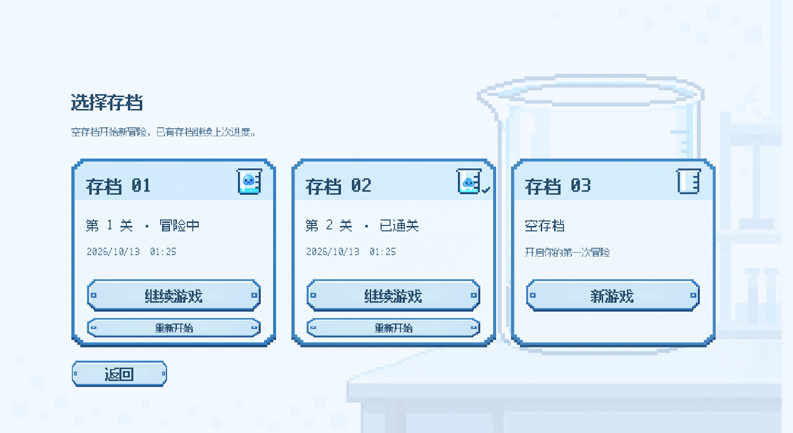

# 主菜单与玩家存档

打开 `Assets/_Game/Scenes/MainMenu.unity` 后按 Play，或使用菜单 `Tools / Slima / 主菜单 / 打开主菜单`。
Build Settings 已将它设为第一个场景，打包后从主菜单启动；直接 Play 关卡仍可用于开发调试。

界面使用统一的蓝白像素素材，封面右侧为悬浮在烧杯中的史莱姆。图片位于
`Assets/_Game/UI/Resources/SlimaUI/`，包括封面、像素标题、按钮、弹窗面板、三种存档状态和音量滑块。
设置、暂停、重开与退出确认共用同一套图片。中文按钮文字与存档时间由代码实时绘制。
纹理采用 Point 采样、关闭 Mipmap 和压缩，生成说明见 [UI 蓝白像素素材](UI蓝白像素素材.md)。
标题、按钮和正文使用专门制作的 [Slima Pixel UI 像素字体](Slima像素字体.md)，包含常规、加粗、斜体和粗斜体。
烧杯与史莱姆已拆为透明 Sprite，可以在 `SlimaFrontEnd` 的 `Beaker Rect` / `Slime Rect` 分别调整位置和大小，见 [封面插画分层](封面插画分层.md)。
主菜单按标注精简为大标题与三个操作按钮：移除了顶部标语、中文副标题、介绍文案、存档提示和英文页脚。
标题放大并额外加粗，按钮使用更大的粗斜体；按钮高度 76、垂直空隙 28，坐标见 `SlimaFrontEnd.DrawHome`。
本次排版通过 Unity 编译与主菜单、存档、设置等运行验证，截图已更新；日志为 `Logs/HomeLayoutValidation.log`。

- **开始游戏**：显示三个独立存档。空槽创建新游戏，已有存档继续上次进度。
- **设置**：主音量、全屏 / 窗口切换，设置保留到下次启动。
- **退出游戏**：确认后退出；Unity 编辑器中停止 Play。
- **重新开始**：确认后仅覆盖选择的存档，回到第一关。

游戏中按 **Esc** 打开暂停菜单，可以保存、修改设置、保存并返回主菜单或退出。
按 **F5** 手动保存。移动、分裂、融合、交互、重开和通关后的稳定状态会自动保存。
打开暂停菜单时，会先等当前移动结束，避免把一半的滑行或融合过程写进存档。

每个存档保存当前场景、地图变化、所有史莱姆的位置与朝向、大小 / 元素 / 形态 / 光学能力、控制权、机关开关与锁存状态、通关状态，以及保存时间。
文件位于 `Application.persistentDataPath/Saves/slot-1.json` 至 `slot-3.json`，与地图编辑器的 `Maps` 数据分开。
存档先写临时文件，再替换旧文件。无法读取的存档会显示提示，选择“重新开始”并确认后才覆盖。

当前关卡顺序为 `map01 → map02 → map03`，到达终点后可点击“下一关”，最后一关完成后可返回主菜单。
要调整关卡顺序，请修改主菜单场景中 `SlimaFrontEnd.levelScenes`，并把对应场景加入 Build Settings。

## 验证

- EditMode 测试：`GameplayProgressTests` 检查分裂角色 / 控制权恢复、地图变化、机关信号恢复和暂停。
- 批处理入口 `SlimaPuzzle.EditorTools.SlimaFrontEndSetup.Validate` 检查存档槽独立性、覆盖写入、损坏存档与启动场景。
- 批处理入口 `SlimaPuzzle.EditorTools.SlimaFrontEndPlayValidation.Run` 检查主菜单、新游戏、暂停、设置、读档、下一关与重新开始，并输出截图。验证使用独立的临时存档目录。
