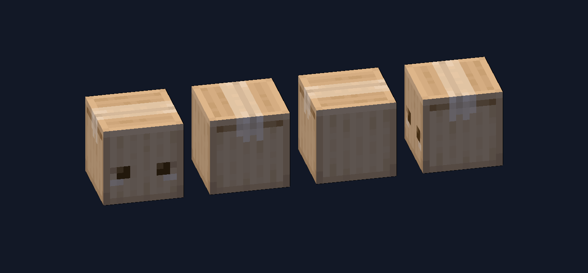
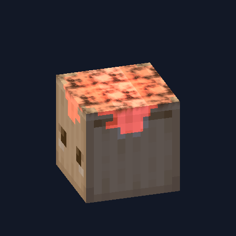

# 可破坏包裹

`Breakable` 现在使用 Create 模组的普通纸箱包裹 `cardboard_12x12`。ID、占格和阻挡移动沿用原配置，火焰史莱姆会自动点燃相邻包裹，旧地图无需转换。

来源：`E:\teaCraft\teaart\teaart\run\mods-lib\create-1.20.1-6.0.8.jar`。

- 模型：`assets/create/models/item/package/cardboard_12x12.json`，原文件保存在 `Assets/_Game/Art/Models/Breakable/`。
- 原贴图：`assets/create/textures/item/package/cardboard.png`，保存在 `Assets/_Game/Art/Textures/Breakable/`。
- Unity 预制体：`Assets/BlockMapEditor/Resources/BlockModels/Breakable.prefab`，地图编辑器和玩法实例自动使用。

保留原模型的六面 UV、贴图和 12 × 12 × 12 像素尺寸；换算后宽、高、深为 0.75 格，底部位于格子地面。使用现有 Toon 材质及像素点采样，并保留纸箱原色。

重新生成：Unity 菜单 **Tools → Slima → 机关 → 生成可破坏包裹模型**。生成过程只依赖已导入的资源，不需要原 Minecraft 工程。

Unity 验证通过：六面 UV 与朝外法线、四方向模型、点采样和原色、移动阻挡、红色固态破坏、销毁后模型移除以及重新放置。报告：`Logs/Package-validation.txt`。

## 燃烧破坏

红色固态（火焰）史莱姆会自动点燃同一层前、后、左、右相邻一格中的包裹，与朝向和控制权无关，大、小火焰史莱姆都生效。斜角、隔两格及上下层不在范围内。移动到相邻格、变成火焰形态或附近新放置包裹都会自动触发；暂停期间不点燃。

移除了包裹上方的 E 提示和手动燃烧操作。火焰史莱姆按 E 不会中断移动；E 继续用于气态凝固和冰霜史莱姆切换光学模式。

点燃后立即从地图数据移除该格，独立的视觉残影用 1.25 秒从顶部烧到底部。燃烧边界采样已有 `SlimeFlameNoise.png` 噪波纹理，形成不规则消融、焦黑边缘、橙黄发光及上升火星。阴影和深度使用同一个消融遮罩。每个实例通过 MaterialPropertyBlock 设置进度，原预制体材质保持完整。重置关卡时清除燃烧残影。

燃烧过程中有三层粒子：沿燃烧边缘向下移动的像素火焰、上升后缩小的火星、缓慢漂移并膨胀淡出的灰烟。火焰和烟雾使用专属粒子材质及同一张噪波纹理。粒子在世界空间模拟，已经升起的粒子不会被发射器向下拖动。包裹消融结束时停止发射，粒子自然消散后清理（最多再保留 0.8 秒）；重置会立即清除整组效果。

回归用例：`Tools/BlockMapEditor/Tests/Editor/DestructibleBurnTests.cs`，覆盖真实玩家预制体的四方向自动点燃、移动靠近、范围与元素限制、暂停、非当前角色及重置恢复。GPU 捕获：`SlimaPackageBurnValidation.Run`。

