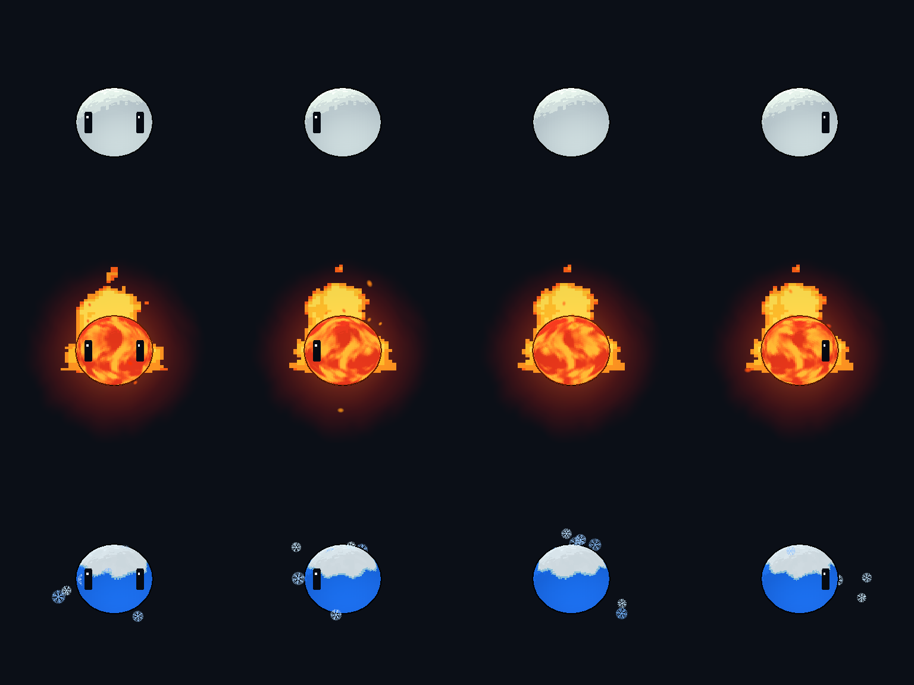
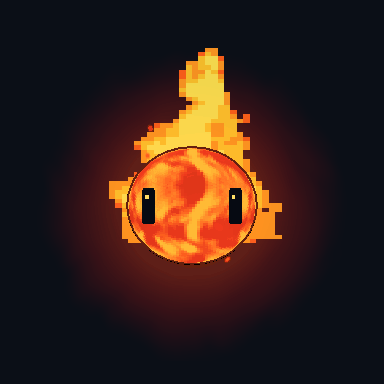

# 史莱姆元素特效

火焰状态的模型表面有像素化的橙红色火纹，身体外还有向上流动的火焰轮廓。外部火焰使用 64×64 可平铺噪波纹理、Point 点采样和 32×48 像素网格，并使用分段的橙红色调。火焰位于身体后方，正面和侧面都能看清眼睛。周围光晕也持续流动，中心偏橙、边缘偏红。点光源使用橙色，并有轻微的游移和不规则亮度变化。火星每秒产生 10 个，随机漂移后逐渐淡出。

身体火纹使用模型局部坐标的三轴投影，按表面朝向平滑混合，避免原先合并 X/Z 坐标造成的球面纹理拉伸，也不依赖球体 UV 的极点。采样坐标固定在模型上并保持像素网格，转向和跳跃不会导致纹理滑动。

冰雪状态的身体顶部覆盖一层淡蓝白色积雪，边缘有像素阶梯和蓝色冰沿，同时使用蓝色点光源和每秒 10 个六角雪花粒子。切换到普通或气态时关闭元素特效并清空粒子；切换大小时同步缩放火焰、光晕和后续粒子。粒子使用世界坐标模拟，已产生的粒子不会随角色转向瞬移。

默认模型移除了前方的朝向凸块，将两只细长黑色竖眼的 16×32 像素纹理贴在球体表面偏前的左右两侧，位置略高于身体中央。眼睛的挂点随模型旋转，纹理沿相机的水平和竖直方向投影，避免球面贴图在俯视镜头下变斜。眼睛使用 Point 点采样，每只眼睛上部偏左都有一个纯白色小正方形高光。正面显示两只眼睛，A/D 转向后的左右侧面各显示一只，背面没有眼睛。纹理不会跟随元素颜色染色。

主要实现：

- `Tools/BlockMapEditor/Runtime/Gameplay/Player/SlimeActor.cs`：模型、光源和元素状态联动。
- `Tools/BlockMapEditor/Runtime/Gameplay/Player/SlimeElementEffects.cs`：粒子、动态光晕和资源生命周期。
- `Assets/_Game/Art/Shaders/SlimaToon.shader`：火纹和模型表面的眼睛贴图；通过默认关闭的史莱姆专用参数启用。
- `Tools/BlockMapEditor/Resources/SlimeElementHalo.shader`、`SlimeFireFlow.hlsl`、`SlimeElementParticle.shader`：流动光晕、噪声火纹与火星/六角雪花形状。
- `Tools/BlockMapEditor/Resources/SlimeEye.png`：眼睛纹理。
- `Tools/BlockMapEditor/Resources/SlimeFlame.shader`、`SlimeFlameNoise.png`：外部像素火焰和循环流动噪波纹理。

Unity 菜单 `Tools → Slima → 验证 → 史莱姆元素特效` 可重新生成专用资源并运行验收，同时输出四个朝向的 GPU 渲染预览及 12 帧外部火焰动画检查。验收比较不同时刻的 GPU 图像，确认火焰轮廓发生变化。日志位于 `Logs/SlimeEffects-validation.txt`，动画帧位于 `Logs/SlimeFlameFrames/`。
