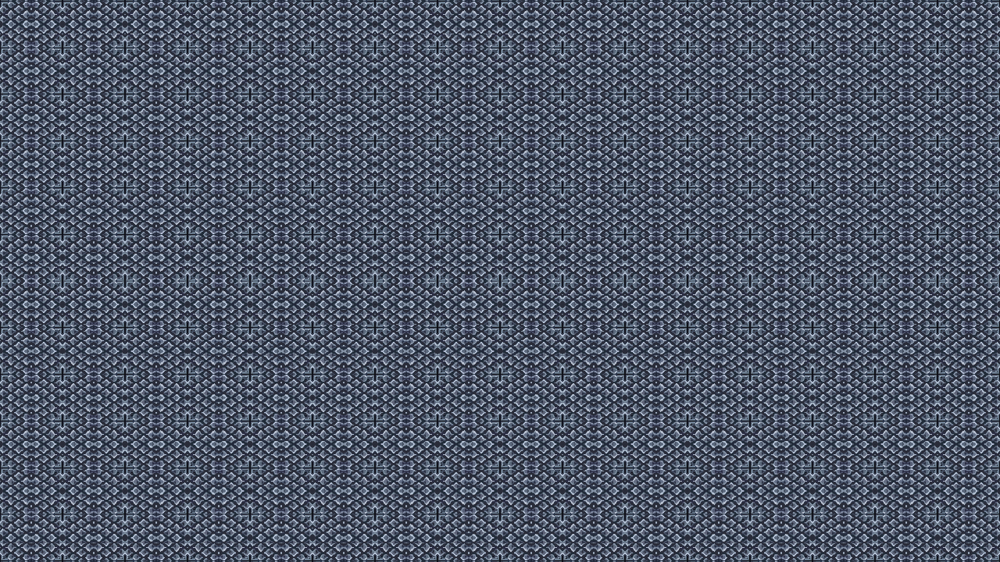
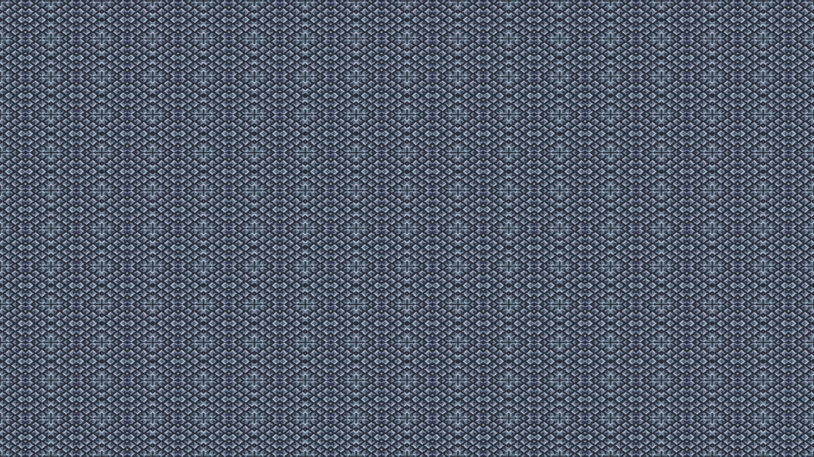

# 地板纹理运动采样检查

第二关的密集金属地板花纹在相机跟随运动时出现采样闪烁。GPU 对照使用同一张 `Lab_Floor_02` 图集、相同的半像素内缩 UV、1280×720 画面、正交视野 4.5，以及 16 帧相机平移。光照固定，排除光影阶梯变化。

## 对照结果

| 配置 | 固定世界采样点的平均时间标准差 |
|---|---:|
| 标准 URP Unlit + Point | 0.025427 |
| Slima Toon + Point | 0.025427 |
| Slima Toon + Point + 描边后处理（不描线） | 0.025427 |
| Slima Toon + Bilinear | 0.007310 |

主体 shader 与 Unlit 的纹理结果一致，开启后处理在这组固定分辨率测试中也没有改变纹理。双线性过滤使受控测试中的运动波动降低约 71%。这个数字用于比较采样稳定性，并不代表每种光照、分辨率或相机运动都会降低同样比例。

| 原 Point 采样 | 修复后的 Bilinear 采样 |
|---|---|
|  |  |

## 修复

- 23 张现有地板图集改为 Bilinear。运行时自动图集与烘焙导入流程采用相同设置，重新烘焙不会恢复 Point。按已有 `_Floor` 命名约定识别地板，并排除 `_Lamp`。
- Mipmap 保持关闭。当前 8×8 图集没有格间隔离边，直接开启普通 Mipmap 会混入相邻格；现有半像素内缩 UV 能安全支持基础级别的双线性过滤。
- 后处理另有独立缺陷：`Frag` 与 `SceneColor` 曾重复应用 `_BlitScaleBias`。现在遮罩、像素网格使用视口 UV，颜色采样仅应用一次源纹理缩放。GPU 渐变测试在 0.75 倍缩放下复现了旧代码 0.169190 的最大采样误差，修复后误差为 0。

地板边缘和花纹会比最近邻采样略柔和。光照阶梯与世界空间颗粒算法保留。

## 验证入口

Unity 批处理执行 `SlimaPuzzle.Rendering.EditorTools.SlimaTextureSamplingValidation.Validate`。
检查主体 / Unlit 对照、运动过滤效果、非 1 倍渲染目标的 UV 缩放、所有地板导入设置与运行时图集设置。
截图输出到 `Logs/TextureSampling`，验证只使用临时场景与克隆的材质 / 纹理。
