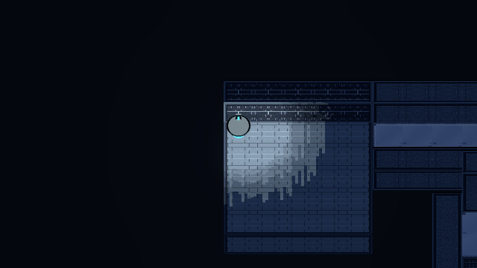
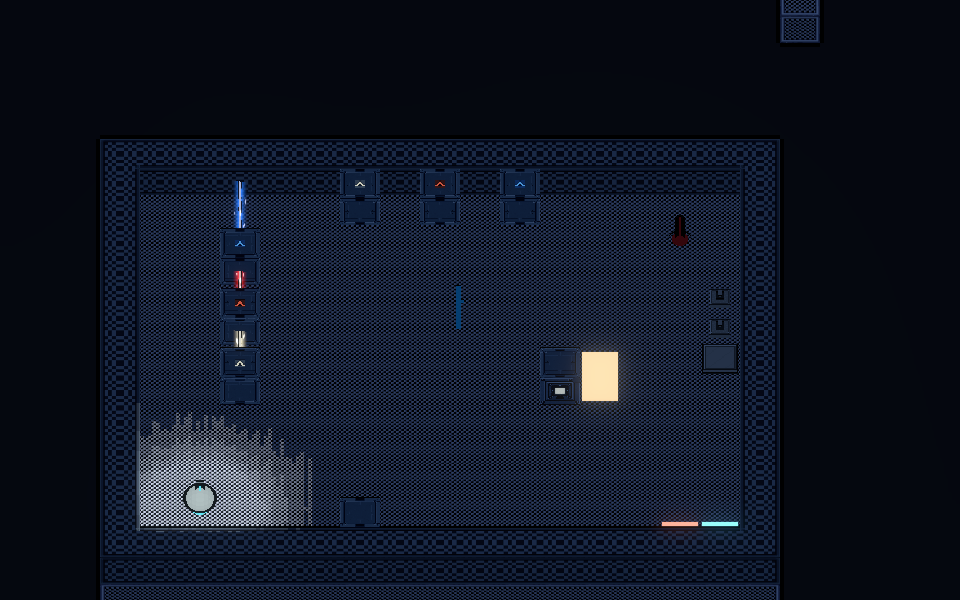

# 场景氛围阴影与角色发光

进入可玩关卡后自动启用：淡蓝环境光、冷色暗部、较弱的主光、角色携带的呼吸点光和相机亮部泛光。沿用 Slima Toon 的像素阶梯光照。角色自身有较弱的材质自发光，附近地板和墙体被点光照亮，墙体和道具会遮挡光线。

旧关卡无需重新烘焙。`BlockMapGameRoot` 会恢复旧地形网格的投射/接收阴影；运行时重建的地形也开启阴影。氛围色通过 MaterialPropertyBlock 设置，不改写共享材质。新生成的角色、机关和道具同样应用氛围设置。

在关卡的 **BlockMapGameRoot → 场景氛围阴影** 中调节：

| 参数 | 默认值 / 用途 |
| --- | --- |
| Scene Atmosphere | 开启；关闭后不覆盖氛围色和主光 |
| Atmosphere Sun Intensity | 0.45，保留远处地形的可读性 |
| Atmosphere Shadow | 冷蓝阴影色 |
| Atmosphere Ambient | 暗部的最低环境色，默认 RGB 0.13 / 0.19 / 0.29 |
| Atmosphere Environment | 场景的淡蓝环境光，默认 RGB 0.22 / 0.30 / 0.42 |

已有 Night Mode 开启时，主光强度仍使用 Night Sun Intensity。

运行中的 **SlimeActor → 角色发光** 可调 Glow Intensity（2.4）、Glow Range（4.5 格）、Emission Strength（0.2，原为 0.65）。光源靠近角色身体，默认离地 0.38 格，随跳跃略微升降，最高限制在当前脚下地面上方 0.75 格，气态悬浮也不越过此高度，避免翻过一格墙顶。红/蓝元素同步改变光色，小型角色缩小照明范围。

Glow Breath Period 默认 2.6 秒；Glow Breath Amount 默认 0.12，强度平滑变化 ±12%，范围变化约 ±4.2%。设为 0 可关闭呼吸；暂停时冻结。呼吸只改变点光的强度和范围，像素噪声继续固定在世界表面。发光角色自身不投射阴影，并使用按法线计算的额外光，避免体内光源把身体颜色冲成白色；环境仍会遮挡角色光源。

角色材质与角色点光的采样格默认缩小到 0.025 世界单位（原角色为 0.1），可通过 SlimeActor 的 Glow Pixel Size 调整。运行时 `_Lamp` 点光及灯具展示材质同样使用 0.025（原为 0.06），照到地面和墙面时也保留更细的像素格。此设置只细化光照采样，保留接收材质原有亮度阶梯；灯具前方光晕仍为平滑中心渐变。显式启用 SlimaToonLight 材质覆盖时，以该组件的 World Pixel Size 为准。

**SlimeActor → 史莱姆透光材质**：Subsurface Strength 默认 0.7、Subsurface Thickness 默认 0.45。材质通过背光透射和前向散射近似次表面散射，让体内点光透出柔和的史莱姆颜色；厚度越低越透光。散射仍受环境阴影遮挡。模型继续写入深度，保持墙体遮挡和描边，不采用整个模型的 alpha 透明。

运行时会清除场景里保存的机关预览，再创建每格唯一的玩法实例，避免门、按钮等动画后露出静止副本。进入 Play 时采用场景里保存的门根朝向；重置快照也保留该朝向。门的模型挂在宽边一端的 DoorHinge 下，开关动画只转铰链，逻辑根和格位保持固定。铰链相对基准的角度为：开启 0°、关闭 Open Angle（默认 90°）。初始关闭姿态立即同步；机关激活与可通行仍对应开启状态。

**BlockMapGameRoot → 相机亮部泛光** 默认开启 Bloom，Intensity = 0.35、Threshold = 0.6、Scatter = 0.55，光晕带轻微淡蓝色。它让高亮区域向周围散出柔光，不额外压暗画面四角。相机开启 HDR 和后处理；Bloom Profile 只在运行时创建，随关卡卸载释放。三个画质档均开启 HDR，低画质也能保留泛光所需的高亮值。

三个 URP 画质档均启用主光和额外光阴影；低画质使用 1024 额外光阴影图，Balanced 使用 2048，HighFidelity 保留 4096。Balanced 的每物体额外光上限改为 8，容纳角色与场景灯光。点光阴影需要六个方向的阴影渲染，增加 GPU 开销。

GPU 验证入口：`SlimaPuzzle.Rendering.EditorTools.SlimaAtmosphereValidation.Run`（Unity batchmode，命令不要加 `-quit`，验证进入 Play 后自行退出）。检查三个画质档的一格墙遮挡与移动阴影、角色光源跟随移动/跳跃及高度限制、呼吸强度和范围变化、元素换色、旧地形阴影开关、淡蓝环境光，以及 Bloom 开关前后的图像差异。输出位于 `Logs/Atmosphere/`。

2026-10-13：临时工程副本中完成 Unity 编译、三个画质档的一格墙 GPU 遮挡/移动阴影对比和 HDR 检查，以及 map01 的 Play 验证。跳跃与气态光源限高、弱自发光、完整呼吸周期的亮度/范围变化、淡蓝环境光和 Bloom 开关图像差异均通过。对照截图：`Logs/Atmosphere/map01-no-bloom.png`；日志：`Logs/Atmosphere-validation.log`。

后续材质与动画修复验证：`SlimaVisualFixValidation.Run` 检查散射透光及遮挡、平滑光晕、map03 每格唯一实例和门朝向/铰链。GPU 与 Play 检查通过；新门生命周期、灯光晕、交互、关联颜色和读档回归共 20 项通过。日志：`Logs/VisualFixes-validation.log`、`Logs/VisualFixes-tests.xml`、`Logs/VisualFixes-regression.xml`。输出图位于 `Logs/VisualFixes/`。

细化采样与门状态校正后：21 项门、交互、读档、关联色和光晕回归全部通过。GPU 确认 `_Lamp` 和角色点光使用 0.025 格、更多像素、镜头移动稳定，保留材质阶梯及显式逐灯覆盖。map03 Play 检查确认角色材质参数生效、关闭 90° / 开启 0°、门根朝向不变及无重复模型。日志：`Logs/DoorSampling-tests.xml`、`Logs/DoorSampling-render.log`、`Logs/DoorSampling-play.log`；截图：`Logs/DoorSampling/`。
