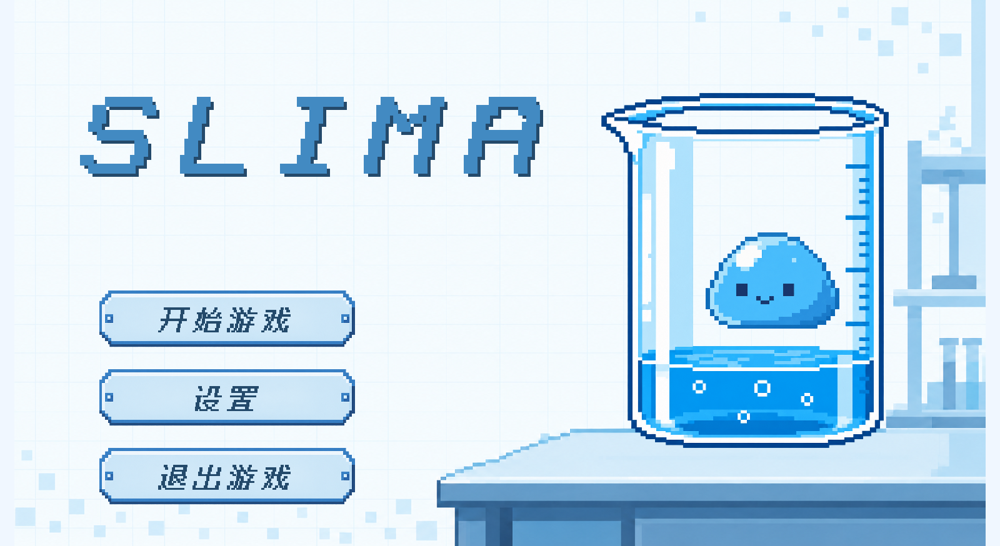

# 封面插画分层

使用内置 image_gen 基于原 cover.png 拆分并修补，三张素材已保存到 Assets/_Game/UI/Resources/SlimaUI/：

| 文件 | 内容 | 尺寸 |
| --- | --- | --- |
| cover-slime.png | 单独史莱姆，透明背景 | 1385 × 1136 |
| cover-beaker.png | 无史莱姆的烧杯，保留玻璃高光、刻度和液体；空白内腔及外围透明 | 1145 × 1374 |
| cover-background.png | 去掉烧杯和史莱姆后的实验室背景 | 1672 × 941 |

两张插画导入为 Sprite (2D and UI)，Point 采样、无 Mipmap、无压缩，透明通道已保留。
原 cover.png 保留作为参考。当前封面从后向前绘制背景、烧杯、史莱姆三个独立层。

## 手动调整

打开 Assets/_Game/Scenes/MainMenu.unity，在 Hierarchy 选择 Slima Main Menu，找到 SlimaFrontEnd 组件。
在 Cover Illustration (1280 x 720) 下调整：

- Beaker Rect：烧杯图片的 X、Y、Width、Height。
- Slime Rect：史莱姆图片的 X、Y、Width、Height。

X 越大越向右，Y 越大越向下；使用 1280 × 720 设计坐标，随屏幕等比例缩放。
图片在矩形中等比例居中显示，透明安全边距包含在图片尺寸中。
建议停止 Play 后调整并保存场景；运行时调整可以即时预览，但退出 Play 后恢复为场景保存的值。
目前仍通过 OnGUI 绘制，Scene 视图不显示 RectTransform 拖动手柄。

## 验证

已检查 PNG 透明通道：史莱姆外围透明、实体中心保留颜色；烧杯外围和空白内腔透明；背景完全不透明。
Unity 检查通过：两张 Sprite 独立加载、Point 采样、单层纹理、透明导入、场景中的 Rect 参数正确保存。
已查看主菜单与存档页的实际合成截图，图片保持比例，史莱姆悬浮在烧杯中，背景无重复角色。
完整回归复查通过：主菜单、新游戏、暂停、设置、保存、继续、下一关、重开与存档隔离。
首轮回归在下一关断言失败；同一副本复查时记录移动状态为 idle、关卡加载启动，最终全部通过。未修改关卡逻辑。
日志保留在 Logs/SplitCoverValidation.log 和 Logs/SplitCoverValidation-recheck.log；验证副本已清理。

## 最终提示词

### 史莱姆

Use case: background-extraction. Input image is the edit target: the Slima pixel-art game cover. Extract ONLY the single cute blue floating slime in the right-side beaker, as a separate production game sprite. Preserve its exact silhouette, two dark navy square eyes, tiny smile, white upper-left shine, medium blue body and darker blue lower-right shading, square pixel edges, and its current pose. Do NOT redesign or reinterpret the character. Remove ALL glass, beaker, liquid, bubbles, sparkles, laboratory, table, shadows outside the body, grid and background. Subject centered, cropped snugly with a small transparent safety margin; approximately square canvas. The slime BODY must remain fully opaque and colored. Only outside its body must be genuinely transparent alpha. Hard authentic pixel edges; no antialiasing, no soft outline, no white matte, no new props, no text, no watermark. One independent slime cutout PNG, not a sprite sheet.

### 烧杯提取

Use case: precise-object-edit and background-extraction. Input image is the edit target: the Slima pixel-art game cover. Extract ONLY the laboratory BEAKER into an independent production transparent PNG, remove the blue slime from inside it and reconstruct the glass where it was. Preserve the exact open oval rim, little pouring spout on upper left, straight blue pixel glass wall outlines, white pixel highlights, sparse blue graduation marks on right, rounded lower glass base, cyan liquid in bottom quarter, and bubbles in the liquid. Preserve original front-facing perspective, proportions and square pixel style. Tall portrait canvas cropped snugly around complete beaker with a narrow transparent margin. Entire lab, grid, table, tabletop reflection, external shadows and all outside decorations are removed. The empty interior ABOVE the liquid must be TRULY transparent alpha with only sparse semitransparent light blue glass highlights, so a separate slime PNG can be layered inside. Keep bottom liquid solid cyan-blue, preserve white glass highlight pixels as opaque white; do not erase white highlights. Remove slime and all airborne bubbles/sparkles in the empty space. No full pale blue opaque rectangle behind the beaker. No new props, no text, no watermark. Exactly ONE beaker cutout, no slime, not a sheet.

### 烧杯透明边缘修订

Use case: precise-object-edit. Edit this isolated transparent pixel-art beaker sprite ONLY to clean its transparency. Keep exact beaker proportions, open oval rim and spout, blue outlines, WHITE opaque glass highlights down left wall, blue graduation ticks down right, blue liquid and white bubbles at bottom, original pixel style. Remove ALL speckled cyan/blue transparency-removal fringe, tiny detached dots above the rim, mottled pixels inside the mouth, and ragged random patches along the inside glass border. Make all empty interior above liquid truly transparent, with a clean straight stepped pixel boundary: glass left-side white/blue strip at left, thin pale blue strip and graduation ticks at right, completely open transparent rectangular interior between them. Make interior of top oval rim transparent too, clean pixel edge without speckles. NO opaque fill in empty interior. Keep white highlight pixels and liquid fully opaque. Only transparent alpha in empty area and exterior. Flat limited blue-white palette, square hard pixel edges, no cyan halo, no gradients, no blur, no texture or noise. No slime no text no watermark.

### 背景修补

Use case: precise-object-edit. Input is edit target: the Slima pixel-art main-menu cover. Remove ONLY the large right-side glass beaker and the slime inside it, plus beaker/slime-related bubbles and cross sparkles. Reconstruct the pale blue-white grid background and laboratory bench that were hidden by the beaker. Remove the beaker's oval reflection/shadow from tabletop; keep a clean empty bench surface. Keep everything else unchanged: 16:9 composition, left blank space, pale grid, lower left blue square motifs, upper right square motifs, right-side laboratory shelf/stands, blue lab tabletop and front panels. Preserve the exact existing blue-white palette, square pixel edges, viewing angle and original lighting. No replacement subject, no new objects, no text, no beaker, no slime, no watermark. This fully opaque background will be composited with separate beaker and slime layers by Unity.

