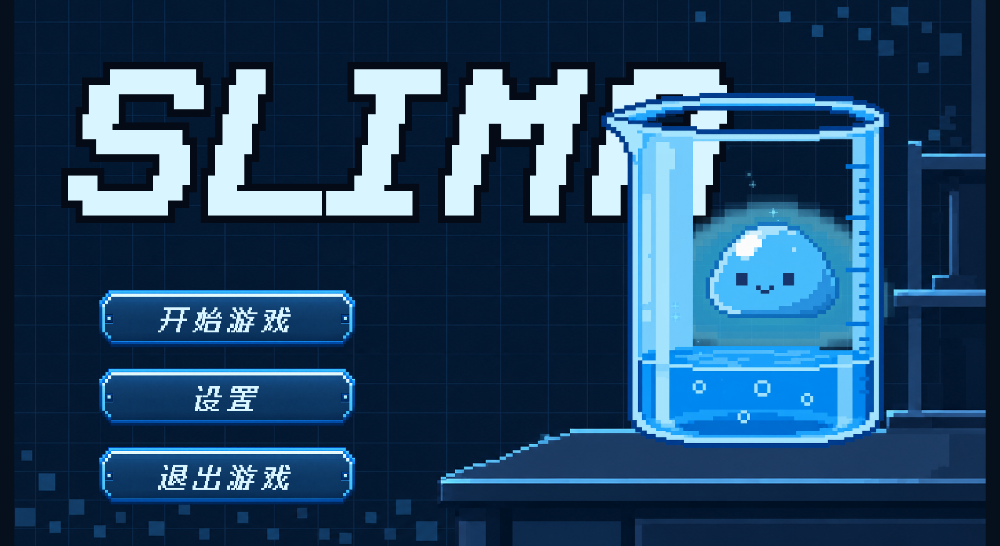

# 暗色 UI 与史莱姆动效

按 2026-10-17 的标注调整：深蓝实验室背景、暗色按钮和存档卡，保留统一的蓝白像素语言。SLIMA 使用现有的 `SlimaPixelUI-BoldItalic.ttf`，字号 240，按可见字面边缘紧密排布，笔画向外扩粗 6 个设计像素，再加 10 像素的深蓝描边。标题先于烧杯绘制，因此杯沿和玻璃高光会遮挡文字。字形按标题区域横向适配，保持大字高度。

## 手动调整位置和动效

打开 `Assets/_Game/Scenes/MainMenu.unity`，选中 Hierarchy 中的 **Slima Main Menu**，在 Inspector 的 **Slima Front End** 组件中修改：

| 字段 | 当前值 | 用途 |
| --- | --- | --- |
| Beaker Rect | 735, 80, 456, 565 | 烧杯位置和大小 |
| Slime Rect | 884, 275, 230, 180 | 史莱姆浮动的基准位置和大小 |
| Title Rect | 70, 58, 870, 280 | 标题位置、适配宽度和文字行框高度 |
| Title Font Size | 240 | 标题字号 |
| Title Letter Spacing | 4 | 加粗后的可见字面边缘间距，去掉斜体字形两侧留白 |
| Title Weight | 6 | 标题浅色笔画向外扩粗的半径 |
| Title Outline Width | 10 | 浅色笔画外侧的深蓝描边宽度 |
| Slime Float Amplitude | 14 | 上下浮动各 14 个设计像素 |
| Slime Float Speed | 1.8 | 浮动角速度，约 3.49 秒一轮 |
| Slime Glow | 0.8 | 透明光晕强度，0 为关闭 |
| Slime Particle Count | 16 | 升起的像素光粒数量，0 为关闭 |

坐标以 1280 × 720 为基准，X 向右、Y 向下，运行时自动居中缩放。此界面由 `SlimaFrontEnd.cs` 的 IMGUI 绘制。按钮栏位在 `DrawHome()` 的三个 Rect 中，现为 `(110,382,340,76)`、`(110,486,340,76)`、`(110,590,340,76)`。退出 Play 模式后修改并保存场景，才能保留调整。

浮动和粒子使用 `Time.unscaledTime`，游戏暂停时仍会运动。史莱姆与烧杯为独立图片。发光由透明青色光晕、呼吸透明度和像素光粒组成，适用于这套 IMGUI 界面。

## 图片与生成方式

使用内置 **imagegen 编辑模式**，以原素材为编辑目标，生成并保存下列暗色 PNG；透明素材保留 alpha。原蓝白版本保留在上级目录。

所有新素材位于 `Assets/_Game/UI/Resources/SlimaUI/Dark/`：

- `cover-background.png`：暗色网格实验室与桌面。
- `button.png`：空白暗色按钮，透明外边距。
- `panel.png`：设置、暂停与确认框共用面板。
- `slot-empty.png`、`slot-saved.png`、`slot-complete.png`：保留的备用存档卡；当前已移除存档选择页面。
- `slider-track.png`、`slider-thumb.png`：音量滑条。
- `slime-glow.png`：独立透明光晕。

继续使用上级目录的 `cover-beaker.png`、`cover-slime.png` 两张独立 Sprite，以及 `Fonts/SlimaPixelUI-BoldItalic.ttf` 等现有字体。全部 UI PNG 使用 Point 过滤、不生成 mipmap、不压缩。

完整提示词见同目录的 `暗色UI生成提示词.json`，包含每张图的编辑目标、透明设置和最终文件路径。

## 验证与预览

早期暗色版本的 Unity 独立验证检查九张素材载入和 Point 过滤、240 字号、当时的 -5 字间距、浮动幅度、暂停时仍浮动，并验证独立存档写入、原子覆盖、损坏存档拒绝和启动场景。日志：`Logs/DarkUiValidation-final.log`。

最新标题版本另在 Unity 副本中渲染正常主菜单、临时隐藏烧杯的对照图和 24 帧动效预览，确认紧密字距、加粗笔画、深色描边与烧杯遮挡。日志：`Logs/TitleTypographyPreview-final.log`。像素对比中，字母间的空白由 42–78 个屏幕像素收紧到 7 像素，浅色笔画面积明显增加；烧杯遮挡了 11,888 个标题笔画像素。记录见 `Logs/TitleTypographyQA.json`。

补齐验证副本中新加入的关卡文件后，完整流程复查也通过：新游戏、保存、继续、暂停、设置、下一关、重开与存档隔离。日志：`Logs/DarkUiFlowValidation.log`。

主菜单预览：

