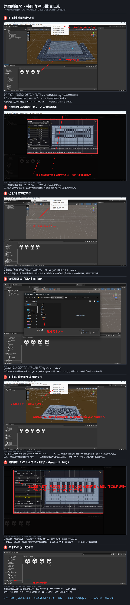

# Slima Puzzle Solving

> **3D 方块地图编辑器 + 可玩关卡原型。**
> 关卡 = 地图编辑器烘出来的场景；没有「地图 → 另一种关卡数据」的中间层，也没有 2D 关卡系统。



<sub>完整流程图（点开看大图）：① 建编辑器场景 → Play 进编辑模式刷地图 → 保存 → ② 烘场景（选同名 json）→ ③ 加游戏根 → Play 试玩</sub>

---

## 一、这个项目是什么

| | |
|---|---|
| **地形 / 关卡编辑器** | `Tools/BlockMapEditor` —— 正交俯视的 3D 方块编辑器：自动包边图集、多种笔刷、朝向、特殊模型、多地图槽；**它就是主地形编辑器** |
| **玩法原型** | 角色在编辑器烘出来的地图上按格跳，走到终点通关（3D 碰撞 + 固定 4 方向 / 90° 档位） |
| **关卡形态** | 每张地图烘成一个 `.unity` 场景：真实几何 + 碰撞体 + 方块数据都在场景里，放在 `Assets/Scenes/` |

引擎：**Unity 2022.3.62f3c1 + URP**。

## 二、快速上手

| 步骤 | 操作 |
|---|---|
| ① | 菜单 `Tools / Slima / 地图编辑器 / ① 创建地图编辑场景`（第一次用这个项目时点一次） |
| ② | 打开地图编辑器场景 → 按 **Play** → 进入地图编辑模式 |
| ③ | 左侧面板选方块刷地图；**在地板之上那一层**刷 `Spawn` / `Exit` 标记；按 `F5` 保存 |
| ④ | 菜单 `② 把地图烘成场景（持久化）` → 弹框里**选与你地图槽同名的 json** |
| ⑤ | 生成 `Assets/Scenes/<地图名>.unity` → 菜单 `③ 把当前场景变成可玩关卡` → 再 Play 就能操控角色 |

**编辑时操作**：左键放置 · Shift+左键删除 · `[` `]` 换方块 · `-` `=` 笔刷 1³/3³/5³ · 右键旋转视角 · 滚轮缩放 · Alt+左键平移 · `1~4` 视角预设 · `P` 像素完美 · `F5` 保存 · `F9` 读取 · `Tab` 进出编辑模式 · `Ctrl+Z` / `Ctrl+Y` 撤销

**试玩时操作**：`WASD` / 方向键 —— 朝世界的 4 个正方向跳一格（朝向只取 0/90/180/270°）· `R` 回到起点

## 三、项目结构

```
Tools/
  BlockMapEditor/            唯一工具包（UPM 本地包 com.gamejam.slima-blockmap-editor）
    Runtime/                 BlockWorld 数据层 · 画笔工具 · 渲染 · 自动包边
                             BlockMapGameRoot 游戏根 · BlockMapGridWalker 角色 · 标记方块
    Editor/                  创建编辑场景 / 烘场景 / 加游戏根 / 导出导入地图 json
    Resources/               方块素材（自动包边贴图、Spawn·Exit 标记、门模型）
    Levels/                  示例地图 json
Assets/
  Scenes/                    ★ 关卡就是这里：地图烘出来的场景（+ BlockMapEditor.unity 是编辑器场景）
  BlockMapEditor/
    Built/                   烘场景产出的材质 + 图集（自动生成，别手改）
    Resources/               Spawn·Exit 模型、角色 Prefab
  _Game/                     游戏自己的素材（见 Assets/_Game/README.md）
    Art/  UI/  Audio/  VFX/  Scripts/  Prefabs/  Scenes/  Data/  Settings/
  Settings/                  URP 配置
Docs/
  开发日志.md                 决策与验证记录
  images/                    本文档用图
```

## 四、地图编辑器要点

**方块从哪来**（放进 `Resources/` 就会被自动收集，不写死常量）：

| 素材 | 含义 |
|---|---|
| `<id>_panel.png` + `<id>_frame.png` | 面板 + 边框 → **自动包边**（8×8 图集，机壳式边框） |
| `<id>_simple.png` | 单图平铺，不包边 |
| `BlockModels/<id>.prefab` | **特殊模型 / 交互道具**（门、起点、终点…）：烘焙时跳过，运行时由 `BlockMapRuntimeSpawner` 按格位实例化 |

**起点 / 终点**：方块 `Spawn`（青）/ `Exit`（橙）—— 半透明标记，烘焙时被跳过、不会挡路；运行时 `BlockMapGameRoot` 读它们的格位：起点生成角色、终点当通关判定，并画一个可见标记。刷的时候**放在地板之上那一层**（地板 `y=0` → 标记刷 `y=1`），别把地板方块顶掉。

**烘焙**（菜单 ②）：真实几何 + **每个 chunk 一个 MeshCollider**（角色站在地形上靠它）+ 方块数据（按 **id** 持久化进场景，重开工程不丢）。

**地图 json**：Play 里 `F5` 存到 `AppData/.../Maps/<槽名>.json`（不在工程里）；要提交给队友用菜单 `导出地图 json 到工程（Git）`。

## 五、约定

1. **关卡场景放 `Assets/Scenes/`**；自己的场景（主菜单、测试场）放 `Assets/_Game/Scenes/` —— 工具产出与手搭场景不混。
2. `Assets/BlockMapEditor/` 是**工具产出目录**（`Built/` 材质图集、`Resources/` 标记与角色），重跑菜单会覆盖。
3. `Assets/_Game/` 是游戏素材区，分区规则见 `Assets/_Game/README.md`。
4. `Assets/_Game/Scripts` 目前落在默认程序集 `Assembly-CSharp`（没有 asmdef），可以直接使用 BlockMap 包的运行时类型（`BlockWorld` / `BlockMapGameRoot` / `BlockMapGridWalker`…）。

## 六、已知问题 / 待办

- `Assets/Scenes/113233.unity` 是用**旧版本**烘的（场景里没有持久化方块数据）→ 重跑一次菜单 ② ，或直接删掉它。
- 角色默认是**灰盒史莱姆**（`BlockMapGameRoot.playerPrefab` 可以换成你的模型）；门、机关等特殊方块同理，给它们做 Prefab 即可。
- 相机默认**跟随角色、正交视野 4.5**（数值越小，场景显示越大）；想对齐地图编辑器里的视角方向，用 `cameraYaw` 取 0/90/180/270。
- 玩法层（机关 / 信号 / 史莱姆队伍 / 关卡 HUD）在 `Tools/BlockMapEditor/Runtime/Gameplay/`，说明见 `Tools/BlockMapEditor/README.md`。
- 主菜单、设置与三个玩家存档已接入，使用说明见 [`Docs/主菜单与存档.md`](Docs/主菜单与存档.md)。音效 / 特效还没做。

## 七、风格化渲染（三渲二）

一套卡通风格 shader：**像素化 + 黑色描边 + 五段阶梯光影（段间用像素化噪声过渡）**，完整用法与参数说明见 [`Docs/三渲二风格化shader.md`](Docs/三渲二风格化shader.md)。

| 文件 | 作用 |
|---|---|
| `Assets/_Game/Art/Shaders/SlimaToon.shader` | 物体卡通材质：五段阶梯光影 + 像素噪声过渡 + 顶点像素吸附 + 可选反转壳描边 |
| `Assets/_Game/Art/Shaders/SlimaToonOutlinePost.shader` | 全屏：像素化 + 深度 Sobel 黑描边 |
| `Assets/_Game/Scripts/Runtime/SlimaToonOutlineFeature.cs` | 上面那个全屏 shader 的 URP Renderer Feature（挂到 Renderer 上即生效） |

> ⚠️ **方块地形请用全屏描边，别用物体 shader 的反转壳描边** —— chunk 是"每个面顶点独立"的合并网格，反转壳会在每个方块棱上裂开。

## 八、开发日志

决策、踩过的坑与验证记录都在 [`Docs/开发日志.md`](Docs/开发日志.md)。
